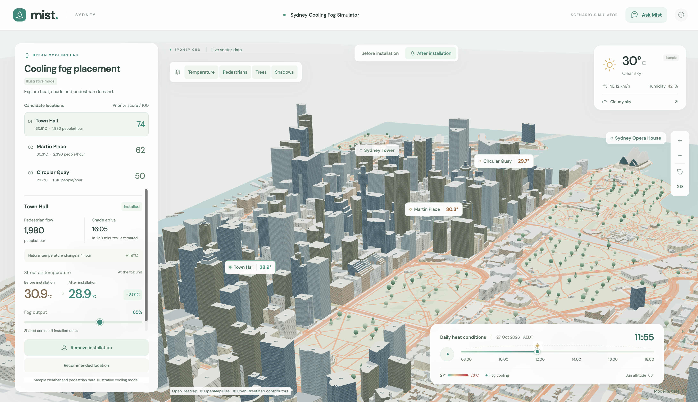
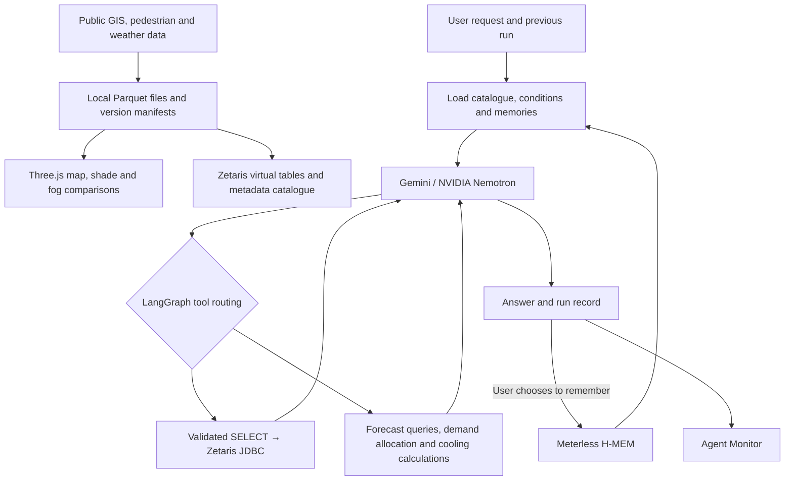

# Cool Sydney



Cool Sydney is a hackathon project that combines spatial, pedestrian and weather data for Sydney's CBD to explore cooling-fog placement and operating conditions. Users can compare shade and assumption-based cooling effects on a 3D map, and ask an agent to suggest candidate street segments, equipment allocations, operating hours and water budgets in natural language.

The agent runs on **LangGraph**, queries supporting data through **Zetaris**, and remembers user preferences and constraints through **Meterless H-MEM**. It supports Gemini and NVIDIA Nemotron as model providers. Its outputs are demand-proportional allocation and operating **proposals for review**, rather than field-validated installation designs or equipment control commands.

## Key features

- **3D map and shade:** Display real GIS buildings, roads and green spaces alongside pedestrian networks, trees and counting sites. Compare pedestrian exposure and shadows from buildings and assumed tree canopies by date and time.
- **Fog simulation:** Manually place FEC-MP003 units on the map and compare air temperature and water use before and after installation. Flow rate, evaporation fraction, mixed air volume and influence radius are scenario assumptions.
- **Evidence-based agent:** Generate read-only SQL against the registered metadata catalogue, then review query results, forecasts, allocations and cooling calculations to produce an answer.
- **Follow-up requests:** Reuse verified candidate sites and operating conditions from previous runs while changing equipment counts, commuting-hour priorities or water budgets.
- **Memory and run monitoring:** Inspect stored user conditions, searches and change history, along with actual graph paths, model requests and responses, SQL and returned rows.
- **Pedestrian evidence:** Keep automated counter observations, hourly counts from periodic survey dates and separately trained forecasts distinct.

## Services

| Interface | Address | Purpose |
| --- | --- | --- |
| Mist user interface | http://127.0.0.1:4173/ | Chat requests and responses, JSON-driven Candidate locations and Fog units |
| Unified backend and monitor | http://127.0.0.1:8766/ | Agent execution, memory storage and search, and run monitoring |
| Agent Monitor | http://127.0.0.1:8766/agent-monitor | Per-run graph, timeline and input/output inspection |
| Zetaris | http://localhost:3000/ | SQL interface for the separately installed data platform |

`meterless-demo/` is an HTTP/UI adapter included in this repository for the H-MEM reference implementation. It is separate from the Meterless Nightshift web product and can be used without Chat Import. The server on port 8766 runs the existing LangGraph agent directly. Agent Monitor and the chat interface on port 4173 share the same run records.

Start the new Mist UI from the repository root with `npm --prefix assets start`. Stop any existing Python static server on port 4173 first. The Node server serves the same `assets/dist` interface and forwards chat requests to the existing agent API on port 8766. Run `npm --prefix meterless-demo start` in a separate terminal. This setup uses only ports 4173 and 8766; stop the legacy server on port 8765. The refresh icon in Ask Mist starts a new scenario, and completed allocation JSON populates Candidate locations on the left in descending order of allocated unit count.

## Recorded run demo for teammates — no API keys required

The repository includes 11 recorded LLM runs, 8 allocation JSON files and 11 related memories in `shared/demo/agent-monitor/`. These include 5 runs from an English scenario alongside existing Korean records. With Node.js 22 or later, you can run the demo without installing packages or downloading data.

```bash
node scripts/run_agent_monitor_demo.js
```

Open **http://127.0.0.1:8766/** and select Run history to inspect prompts, SQL results, LangGraph steps, allocation tables and JSON. This is a **read-only demo** of saved records. It requires no new LLM requests, Docker, Zetaris, H-MEM server or API keys. If port 8766 is in use, run `PORT=8767 node scripts/run_agent_monitor_demo.js`.

To follow the English conversation, start with the run beginning **Across all pedestrian survey sites…** in Run history. The sequence is: find the top 10 sites → allocate 50 units with 3,000 L → prioritise commuting hours → reduce to 30 units → reduce the water budget to 1,500 L. The final result opens by default, and the number of memories retrieved across the runs is 0 → 1 → 2 → 3 → 4. Applying commuting-hour priority changed Site 102 from 5 to 6 units and Site 106 from 4 to 3 units. The calculated total passage count within operating hours was 336,210.

- Numeric tables, totals and plan summaries are generated from saved calculation results. Original model responses are preserved in the run details.
- The existing Korean records retain errors from before the fix. A run in which the commuting-hour request remained `false` has not been rewritten as a successfully updated plan. The included English runs use the corrected condition interpretation.
- Regenerate the demo data from current completed runs with `node scripts/export_agent_monitor_demo.js`. The export does not copy `.env` or the original `.notebook/`, and removes API keys, authentication fields and personal local paths. Review the generated output before committing it.

For new live requests and the map, follow the standard setup below.

## Getting started

To try the English scenario from the beginning in Agent Monitor, restart the server on port 8766, refresh the page and select **Start new scenario**. Previous records are preserved, while memory retrieval is restricted to that scenario's Meterless memories. Leave **Remember conditions** enabled to save the current scenario's conditions. **Continue the selected run** is enabled automatically after the first request; send follow-up requests from the most recent completed run. Simply clearing the Continue checkbox still allows existing geographic memories to be retrieved. English questions receive results in English.

Run the following commands from **the Git repository root containing this README**. In the `.publish` workspace described here, that location is `/Users/suyeongkim/cs/openAgent/.publish/GENAI_WORKS_HACKATHON`. The outer `openAgent/cool-sydney` directory contains older code, so check which directory you are running from.

Requirements:

- Node.js **22.19 or later** and npm
- Python and PyArrow (`cool-sydney/requirements.txt`)
- Internet access for the initial dependency installation and public data downloads
- Docker and a healthy Zetaris driver for agent SQL execution, plus the JDK's `javac` for registration

### 1. Install dependencies and configure the environment

```bash
python3 -m venv .venv
.venv/bin/python -m pip install -r cool-sydney/requirements.txt
npm --prefix cool-sydney ci
```

If `.env` does not already exist, copy `.env.example` to `.env` and enter the key for your chosen provider. The application's configuration and the Zetaris installation bundle's `.env` are separate.

| Variable | Purpose |
| --- | --- |
| `MODEL_PROVIDER` | `gemini` or `nvidia`; defaults to `gemini` |
| `GEMINI_API_KEY`, `GEMINI_MODEL` | Gemini authentication and model; see `.env.example` for the default model |
| `MODEL_API_KEY`, `MODEL_BASE_URL`, `NEMOTRON_MODEL` | NVIDIA authentication, endpoint and model |
| `METERLESS_BASE_URL` | Memory service address; defaults to `http://127.0.0.1:8766` |
| `ZETARIS_DRIVER_CONTAINER` | Container used by the agent's JDBC tool; defaults to `zetaris-driver-1` |
| `ZETARIS_REST_URL`, `ZETARIS_ORG_ID`, `ZETARIS_API_KEY`, `ZETARIS_SQL_PATH` | The dashboard's existing REST registration and query features |
| `COOL_SYDNEY_PORT` | Dashboard port; defaults to `8765` |
| `COOL_SYDNEY_PYTHON` | Path to the Python executable with PyArrow installed |

The application server resolves settings in this order: shell environment variables → repository `.env` → the outer `.env` of the `.publish` workspace. Provider keys are used only on the server. `.env`, data, `.notebook/`, `node_modules/` and local platform bundles are excluded from Git.

### 2. Prepare map data and analysis-date data

```bash
bash scripts/run_dashboard.sh --date 2025-12-19
```

The script checks the Python environment, collects and validates GIS data and CBD data for the selected date, then starts the web server. It also starts the legacy dashboard on port 8765, so stop it after data preparation. Start the current interface on port 4173 with `npm --prefix assets start`. The first run takes time to download source data and generate Parquet files. Subsequent runs reuse cached data and validated bundles.

If no date is supplied, the default collection date is `2025-01-15`. `--map-only` skips CBD data preparation. The agent's analysis date is **fixed by the active catalogue**: changing only the date on the map does not change the date of the agent's supporting data.

If the data is already prepared, start just the server with:

```bash
npm --prefix meterless-demo start
# Run in a separate terminal
npm --prefix assets start
```

Street-level air-temperature observations are an optional dataset. Prepare the source CSV, then import it with `npm --prefix cool-sydney run import:microclimate`. See the [map and data guide](cool-sydney/README.md).

### 3. Register data with Zetaris

Prepare the local Zetaris platform and its login and registry credentials separately. The installation bundle is not included in Git. In the workspace described above, it is located in the outer `openAgent/zetaris-platform` directory. Start the platform and confirm that the driver is healthy.

Once the analysis-date data is ready, run the following from the repository root in another terminal:

```bash
python3 scripts/register_zetaris.py --date 2025-12-19 --sync
```

This registers the core GIS/CBD tables, any saved optional datasets and the metadata catalogue. The sequence is: verify file checksums → copy files to the driver → register tables → validate SQL row counts. Only after all checks pass does `catalog/current.json` switch to the new registration version. Forecast and periodic survey datasets that have not been saved are marked `SKIP`.

- If the installation bundle cannot be found automatically, specify `--platform /absolute/path/to/zetaris-platform`.
- If your driver has a different name, set the registration command's `--container` and the application's `ZETARIS_DRIVER_CONTAINER` to the same value.
- Add `--prepare-only` to generate the registration plan and SQL without switching the active catalogue.

**Agent SQL uses a JDBC connection inside Docker.** This is a separate path from the dashboard's existing REST API registration and queries. The cloud portal's AWS Credentials and Clusters screens are not the interfaces for this local setup.

### 4. Start H-MEM and the monitor

On a new machine, download the official reference engine first:

```bash
npm --prefix meterless-demo ci
npm --prefix meterless-demo run setup
```

Once the engine is available in `meterless-demo/vendor/hmem`, start it in a separate terminal:

```bash
COOL_SYDNEY_PROJECT_ROOT="$PWD" npm --prefix meterless-demo start
```

The environment variable tells Agent Monitor to read interface files from **the current repository**. The agent runs directly in this process on port 8766; no separate process on port 8765 is used.

The H-MEM engine and its basic UI do not require a model API key. State is stored in `.notebook/` within the service directory. Memories from an older instance running in the outer `openAgent/meterless-demo` remain in that directory and are not transferred by cloning the Git repository.

For Korean text, use the UI's **literal substring search**. The H-MEM reference engine's ranked search uses deterministic hash embeddings and does not provide Korean semantic search. The agent retrieves up to 12 user memories using a geographic prefix. If the service is offline, it records `unavailable` and continues without creating memories.

## Agent demo

After registering the data and configuring the model, submit requests through the dashboard or Agent Monitor. Enable **Continue the selected run** in the monitor to continue a selected completed run.

1. “Find 10 survey sites with high pedestrian counts during commuting hours, using 19 December 2025 as the analysis date.”
2. “Allocate 50 fog units across those 10 sites. Operate from 10:00 to 18:00 with a water budget of 3000 L.”
3. “Prioritise commuting hours.”
4. “Reduce the equipment count to 30 units and the water budget to 1500 L.”

Follow-up requests retain the conversation's verified site IDs, survey period and conditions, changing only the conditions explicitly specified. Enabling `remember_request` or saving feedback also records conditions and their sources in H-MEM. Previous runs are linked through `previous_run_id` and recovered from disk, keeping conversation history separate from memory service availability.

Periodic survey allocations use each site's hourly counts from the same survey period. If there are fewer units than candidate sites, there is no guarantee that every site will receive a unit. Commuting-hour weights apply to 08:00–10:00 and 17:00–19:00 within the configured operating hours. Changing the weights does not automatically extend operating hours.

For each run, the monitor shows the question, applied conditions, invoked nodes, prompts, SQL, returned rows, calculation results, errors and answer. It does not display the model's internal reasoning.

## Architecture



| Component | Code |
| --- | --- |
| Web server, API and local jobs | [`cool-sydney/server.js`](cool-sydney/server.js), [`service.js`](cool-sydney/service.js) |
| Map, fog and route interface | [`cool-sydney/src/`](cool-sydney/src/), [`build.js`](cool-sydney/build.js) |
| LangGraph and conversation context | [`agent.js`](cool-sydney/agent.js), [`agent-context.js`](cool-sydney/agent-context.js) |
| SQL restrictions and connections | [`agent-sql.js`](cool-sydney/agent-sql.js), [`agent-connectors.js`](cool-sydney/agent-connectors.js) |
| Allocation and forecasting | [`fog-allocation.js`](cool-sydney/fog-allocation.js), [`agent-forecast.js`](cool-sydney/agent-forecast.js) |
| Data registration and model training | [`scripts/`](scripts/) |
| Memory UI and monitor proxy | [`meterless-demo/`](meterless-demo/) |

Each run is limited to **4 model calls** and **6 tool executions**, with **60 seconds** per model request and **3 minutes** for the entire run. SQL is restricted to a single SELECT against catalogue tables, using at most 3 tables and returning at most 100 rows. Writes, CTEs, subqueries, external file functions and similar operations are rejected. Errors are returned to the model within the call limits.

## Optional data preparation

Periodic pedestrian surveys and automated sensor-based forecasts are separate sources of evidence. Save the datasets you need, then rerun `--sync`.

```bash
# Collect periodic survey sites and hourly counts
python3 scripts/fetch_walking_surveys.py

# Collect automated counter history and generate forecasts for the analysis date
python3 scripts/fetch_pedestrian_history.py
python3 scripts/train_pedestrian_forecast.py --date 2025-12-19

# Register the prepared datasets and update the catalogue
python3 scripts/register_zetaris.py --date 2025-12-19 --sync
```

Forecasts are stored in a separate `pedestrian_forecasts` table with model and validation reports; they do not overwrite observed `pedestrian_counts`. Choose an appropriate weekday or weekend survey period before the analysis date.

## Data and limitations

The default data directory is `data/cool-sydney/`.

```text
data/cool-sydney/
├── raw/                   # Original responses, tiles and CSV files
├── processed/             # GIS/CBD/survey/forecast Parquet files and manifests
├── catalog/current.json   # Agent metadata catalogue activated after validation
├── zetaris-registration/  # Registration SQL, plans and validation results
├── agent-runs/            # Conversation, SQL, tool, error and answer records
└── runs/                  # Map, shade and route calculation results
meterless-demo/.notebook/   # H-MEM memories and audit history (separate service)
```

- Keep the dates and sources of weather model values, historical sensor observations, survey counts and statistical forecasts distinct. Missing observations do not mean zero pedestrians. Passage counts are not counts of unique pedestrians.
- Forecasts from four automated sensors should not be interpreted as observed demand across all CBD streets. Periodic survey allocations are also scenarios proportional to demand on the relevant survey dates.
- The fog model estimates air cooling and water use under stated assumptions. It does not provide measured street-level, ground-surface or apparent temperatures, CFD, certified equipment performance or globally optimal placement.
- Map-derived building heights, circular canopy assumptions, pedestrian network connectivity and differing collection dates introduce uncertainty. Candidate accessible routes and installation feasibility require field verification.
- H-MEM is a reference implementation using JSON storage and hash-based retrieval. It is intended for a single-user demo; do not write to it from the CLI and UI simultaneously.

## Validation

```bash
npm --prefix cool-sydney test
python3 -m unittest discover -s scripts/tests
npm --prefix meterless-demo test
```

Tests cover GIS/Parquet round trips and data quality, physical calculations and water budgets, read-only SQL restrictions, actual LangGraph execution loops, follow-up requests, memory and monitor UI logic. H-MEM tests run against temporary storage after the reference engine has been prepared. Some graph tests are skipped if LangGraph is not installed.

Tests that mock external model and Zetaris responses are separate from live service checks. In an environment with the required installations, keys and network access, inspect `/api/agent/status` and the SQL and tool results from actual runs. Connection code is implemented, but `external_connections_verified` in the status response is always `false`; it is not a signal that automatic verification has completed.

## Further reading

- [Map, data and model details](cool-sydney/README.md)
- [H-MEM example and local UI](meterless-demo/README.md)
- [Initial Cool Sydney architecture](shared/cool-sydney-architecture.md) — design record from before implementation
- [Initial IKEA AR concept](shared/ikea-ar-architecture.md) — a separate design record unrelated to the current application
- [Event participation guide](shared/welcome_guide.txt)

For external data and vendor code sources and licences, see the [detailed Cool Sydney documentation](cool-sydney/README.md#출처와-라이선스) and the relevant licence files in `vendor/`.
