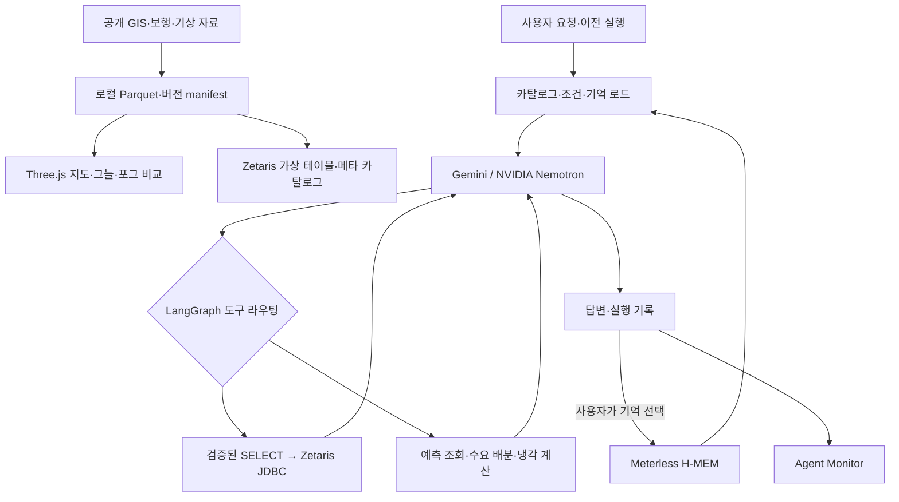

# Cool Sydney

시드니 CBD의 공간·보행·기상 데이터를 연결해 쿨링 포그의 배치와 운영 조건을 검토하는 해커톤 프로젝트입니다. 3D 지도에서 그늘과 가정 기반 냉각 효과를 비교하고, 에이전트에 자연어로 후보 구간·장비 수·운영 시간·물 예산을 요청할 수 있습니다.

에이전트는 **LangGraph**로 실행되며 **Zetaris**에서 근거 데이터를 조회하고 **Meterless H-MEM**에서 사용자 조건을 기억합니다. 모델 공급자는 Gemini 또는 NVIDIA Nemotron을 선택합니다. 결과는 수요에 비례한 배분·운영 **검토안**이며, 현장 검증을 거친 설치 설계나 장비 제어 명령은 아닙니다.

## 주요 기능

- **3D 지도와 그늘:** 실제 GIS 건물·도로·녹지, 보행망·수목·계수 지점을 표시하고 날짜·시각별 건물/가정 기반 수관 그림자와 보행 노출을 비교합니다.
- **포그 시뮬레이션:** FEC-MP003 장비를 지도에 수동 배치하고 설치 전·후 공기온도와 물 사용량을 비교합니다. 유량·증발 비율·혼합 공기량·영향 반경은 시나리오 가정입니다.
- **근거 기반 에이전트:** 등록된 메타 카탈로그에 맞춰 읽기 전용 SQL을 작성하고, 조회·예측·배분·냉각 계산 결과를 검토해 답합니다.
- **후속 요청:** 이전 실행의 검증된 후보 지점과 운영 조건을 이어받아 장비 수, 출퇴근 우선순위, 물 예산을 변경합니다.
- **기억과 실행 모니터:** 사용자 조건의 저장·검색·변경 이력, 실제 그래프 경로, 모델 요청/응답, SQL과 반환 행을 확인합니다.
- **보행 근거:** 자동 계수 관측, 정기 조사일의 시간별 계수, 별도로 학습한 예측을 구분해 사용합니다.

## 서비스 구성

| 화면 | 주소 | 용도 |
| --- | --- | --- |
| Cool Sydney | http://127.0.0.1:8765/ | 3D 지도, 포그 비교, 에이전트 요청 |
| H-MEM 로컬 UI | http://127.0.0.1:8766/ | 기억 목록·조건 저장/수정·검색·이력 |
| Agent Monitor | http://127.0.0.1:8766/agent-monitor | 실행별 그래프·타임라인·입출력 검사 |
| Zetaris | http://localhost:3000/ | 별도로 설치한 데이터 플랫폼의 SQL 화면 |

`meterless-demo/`는 이 저장소에 포함한 H-MEM 참조 구현용 HTTP/UI 어댑터입니다. Meterless Nightshift 웹 제품과 별개이며, Chat Import 없이 사용할 수 있습니다. Agent Monitor는 8765의 에이전트 API를 로컬 프록시로 읽습니다.

## 시작하기

아래 명령은 **이 README가 있는 Git 저장소 루트**에서 실행합니다. 현재 작업 공간에서는 `/Users/suyeongkim/cs/openAgent/.publish/GENAI_WORKS_HACKATHON`입니다. 바깥 `openAgent/cool-sydney`에는 이전 코드가 있으므로 실행 위치를 구분하세요.

필요 환경:

- Node.js **22.19 이상**, npm
- Python과 PyArrow (`cool-sydney/requirements.txt`)
- 최초 의존성·공개 데이터 수집을 위한 인터넷 연결
- 에이전트 SQL 실행 시 Docker, 정상 실행 중인 Zetaris driver, 등록 시 JDK의 `javac`

### 1. 의존성과 설정

```bash
python3 -m venv .venv
.venv/bin/python -m pip install -r cool-sydney/requirements.txt
npm --prefix cool-sydney ci
```

기존 `.env`가 없으면 `.env.example`을 `.env`로 복사하고 사용할 공급자의 키를 입력합니다. 앱 설정과 Zetaris 설치 번들의 `.env`는 별도입니다.

| 변수 | 용도 |
| --- | --- |
| `MODEL_PROVIDER` | `gemini` 또는 `nvidia`; 기본 `gemini` |
| `GEMINI_API_KEY`, `GEMINI_MODEL` | Gemini 인증·모델; 모델 기본값은 `.env.example` 참고 |
| `MODEL_API_KEY`, `MODEL_BASE_URL`, `NEMOTRON_MODEL` | NVIDIA 인증·엔드포인트·모델 |
| `METERLESS_BASE_URL` | 기억 서비스 주소; 기본 `http://127.0.0.1:8766` |
| `ZETARIS_DRIVER_CONTAINER` | 에이전트 JDBC 도구가 사용하는 컨테이너; 기본 `zetaris-driver-1` |
| `ZETARIS_REST_URL`, `ZETARIS_ORG_ID`, `ZETARIS_API_KEY`, `ZETARIS_SQL_PATH` | 대시보드의 기존 REST 등록·조회 기능 |
| `COOL_SYDNEY_PORT` | 대시보드 포트; 기본 `8765` |
| `COOL_SYDNEY_PYTHON` | PyArrow가 설치된 Python 실행 파일 경로 |

앱 서버의 설정 우선순위는 셸 환경 변수 → 저장소 `.env` → `.publish` 작업 공간의 바깥 `.env`입니다. 공급자별 키는 서버에서만 사용합니다. `.env`, 데이터, `.notebook/`, `node_modules/`, 로컬 플랫폼 번들은 Git에서 제외합니다.

### 2. 지도와 분석일 자료 준비

```bash
bash scripts/run_dashboard.sh --date 2025-12-19
```

스크립트가 Python 환경을 확인하고 GIS·해당 날짜의 CBD 자료를 수집/검증한 뒤 웹서버를 시작합니다. 완료 후 http://127.0.0.1:8765/ 를 엽니다. 처음에는 원본 다운로드와 Parquet 생성에 시간이 걸립니다. 재실행 시 저장한 캐시와 검증된 묶음을 재사용합니다.

날짜를 생략하면 기본 수집일은 `2025-01-15`입니다. `--map-only`는 CBD 자료 준비를 생략합니다. 에이전트의 분석일은 **활성 카탈로그에 고정**되므로 지도에서 날짜만 바꾼다고 에이전트 근거 날짜가 바뀌지는 않습니다.

이미 자료가 준비됐다면 아래 명령으로 서버만 시작할 수 있습니다.

```bash
node cool-sydney/server.js
```

거리 기온 실측은 별도 선택 자료입니다. 원본 CSV를 준비한 후 `npm --prefix cool-sydney run import:microclimate`로 가져옵니다. [지도·데이터 상세 안내](cool-sydney/README.md)를 참고하세요.

### 3. Zetaris에 등록

Zetaris 로컬 플랫폼과 로그인/레지스트리 정보는 별도로 준비해야 합니다. 번들은 Git에 포함하지 않습니다. 이 작업 공간의 번들은 바깥 `openAgent/zetaris-platform`에 있습니다. 플랫폼을 시작하고 driver가 healthy 상태인지 확인하세요.

분석일 자료가 준비되면 다른 터미널의 저장소 루트에서 실행합니다.

```bash
python3 scripts/register_zetaris.py --date 2025-12-19 --sync
```

기본 GIS/CBD 테이블과 저장된 선택 자료·메타 카탈로그를 등록합니다. 순서는 파일 체크섬 확인 → driver로 복사 → 테이블 등록 → SQL 행 수 검증입니다. 모든 검증이 성공한 뒤 `catalog/current.json`을 새 등록 버전으로 전환합니다. 저장되지 않은 예측·정기 조사 자료는 `SKIP`으로 표시됩니다.

- 설치 번들을 자동으로 찾지 못하면 `--platform /절대경로/zetaris-platform`을 지정합니다.
- driver 이름이 다르면 등록 명령의 `--container`와 앱의 `ZETARIS_DRIVER_CONTAINER`를 같은 값으로 맞춥니다.
- `--prepare-only`를 추가하면 등록 계획과 SQL만 만들고 활성 카탈로그를 전환하지 않습니다.

**에이전트 SQL은 Docker 안의 JDBC 연결**을 사용합니다. 대시보드의 기존 REST API 등록·조회와 다른 경로입니다. 클라우드 포털의 AWS Credentials·Clusters 화면은 이 로컬 실행 화면이 아닙니다.

### 4. H-MEM과 모니터 시작

처음 실행하는 컴퓨터에서는 공식 참조 엔진을 받아야 합니다.

```bash
npm --prefix meterless-demo ci
npm --prefix meterless-demo run setup
```

엔진이 `meterless-demo/vendor/hmem`에 준비되면 별도 터미널에서 실행합니다.

```bash
COOL_SYDNEY_PROJECT_ROOT="$PWD" npm --prefix meterless-demo start
```

환경 변수는 Agent Monitor가 **현재 저장소의** 화면 파일을 읽도록 지정합니다. 기본 프록시 대상은 `http://127.0.0.1:8765`입니다. 기억 UI만 쓰려면 Cool Sydney 서버 없이도 사용할 수 있습니다.

H-MEM 엔진과 기본 UI에는 모델 API 키가 필요하지 않습니다. 상태는 해당 서비스 디렉터리의 `.notebook/`에 저장됩니다. 기존 바깥 `openAgent/meterless-demo`에서 실행하던 기억도 그 디렉터리에 남아 있으며, Git clone으로 이전되지 않습니다.

한국어는 UI의 **원문 포함 검색**을 사용하세요. H-MEM 참조 엔진의 순위 검색은 결정적 해시 임베딩을 사용하며 한국어 의미 검색을 제공하지 않습니다. 에이전트는 지역 prefix로 사용자 기억 최대 12개를 조회합니다. 서비스가 꺼져 있으면 기억을 만들지 않고 `unavailable`을 기록한 뒤 진행합니다.

## 에이전트 데모

자료 등록과 모델 설정을 마친 후 대시보드나 Agent Monitor에서 요청합니다. 모니터의 **Continue the selected run**을 켜면 선택한 완료 실행을 이어갑니다.

1. “2025년 12월 19일 기준으로 출퇴근 시간대 보행량이 많은 조사 지점 10곳을 찾아줘.”
2. “그 10곳에 포그 50대를 배분해줘. 운영은 10시부터 18시까지, 물 예산은 3000L야.”
3. “출퇴근 시간을 우선해줘.”
4. “장비를 30대로 줄이고 물 예산도 1500L로 바꿔줘.”

후속 요청은 대화의 검증된 지점 ID·조사 기간·조건을 유지하고 명시한 조건만 변경합니다. `remember_request`를 켜거나 피드백을 저장하면 조건과 출처를 H-MEM에도 남깁니다. 이전 실행은 `previous_run_id`로 연결하고 디스크에서 복구하므로 기억 서비스 장애와 대화 이력을 구분합니다.

정기 조사 배분에는 동일한 조사 기간의 지점별 시간 계수를 사용합니다. 후보 지점 수보다 장비가 적으면 모든 지점에 한 대씩 배정된다고 보장하지 않습니다. 출퇴근 가중치는 운영 시간 안의 08~10시·17~19시에 적용합니다. 가중치를 바꿔도 운영 시간을 임의로 늘리지 않습니다.

모니터에서는 실행별로 질문, 적용 조건, 호출한 노드, 프롬프트, SQL, 반환 행, 계산 결과, 오류와 답변을 확인할 수 있습니다. 이 화면은 모델의 내부 추론을 표시하는 기능이 아닙니다.

## 구조



| 구성 요소 | 코드 |
| --- | --- |
| 웹서버·API·로컬 작업 | [`cool-sydney/server.js`](cool-sydney/server.js), [`service.js`](cool-sydney/service.js) |
| 지도·포그·경로 화면 | [`cool-sydney/src/`](cool-sydney/src/), [`build.js`](cool-sydney/build.js) |
| LangGraph·대화 맥락 | [`agent.js`](cool-sydney/agent.js), [`agent-context.js`](cool-sydney/agent-context.js) |
| SQL 경계·연결 | [`agent-sql.js`](cool-sydney/agent-sql.js), [`agent-connectors.js`](cool-sydney/agent-connectors.js) |
| 배분·예측 | [`fog-allocation.js`](cool-sydney/fog-allocation.js), [`agent-forecast.js`](cool-sydney/agent-forecast.js) |
| 데이터 등록·모델 학습 | [`scripts/`](scripts/) |
| 기억 UI·모니터 프록시 | [`meterless-demo/`](meterless-demo/) |

모델 호출은 실행당 최대 **4회**, 도구 실행은 최대 **6회**, 모델 요청당 **60초**, 전체 실행은 **3분**으로 제한합니다. SQL은 카탈로그에 있는 테이블의 단일 SELECT, 최대 3개 테이블·100행으로 제한하며 쓰기·CTE·서브쿼리·외부 파일 함수 등을 거부합니다. 오류는 호출 한도 안에서 모델에 반환합니다.

## 선택 데이터 준비

정기 보행 조사와 자동 센서 기반 예측은 서로 다른 근거입니다. 필요한 자료를 저장한 뒤 `--sync`를 다시 실행하세요.

```bash
# 정기 조사 지점·시간별 계수 수집
python3 scripts/fetch_walking_surveys.py

# 자동 계수 이력 수집 및 분석일 예측 생성
python3 scripts/fetch_pedestrian_history.py
python3 scripts/train_pedestrian_forecast.py --date 2025-12-19

# 준비된 자료를 등록하고 카탈로그 갱신
python3 scripts/register_zetaris.py --date 2025-12-19 --sync
```

예측은 별도 `pedestrian_forecasts` 테이블과 모델·검증 보고서에 보관하며 관측 `pedestrian_counts`를 덮어쓰지 않습니다. 조사 날짜는 분석일 이전의 적절한 평일/주말 기간을 선택해야 합니다.

## 데이터와 한계

기본 저장 위치는 `data/cool-sydney/`입니다.

```text
data/cool-sydney/
├── raw/                   # 원본 응답·타일·CSV
├── processed/             # GIS/CBD/조사/예측 Parquet·manifest
├── catalog/current.json   # 검증 후 활성화한 에이전트 메타 카탈로그
├── zetaris-registration/  # 등록 SQL·계획·검증 결과
├── agent-runs/            # 대화·SQL·도구·오류·답변 기록
└── runs/                  # 지도·그늘·경로 계산 결과
meterless-demo/.notebook/   # H-MEM 기억·감사 이력 (별도 서비스)
```

- 기상 모델값, 과거 센서 실측, 조사일 계수와 통계 예측의 날짜·출처를 구분합니다. 미관측은 0명이 아닙니다. 통과 횟수는 고유 보행자 수가 아닙니다.
- 자동 센서 4곳의 예측을 전체 CBD 거리의 수요 실측으로 해석하지 않습니다. 정기 조사 배분도 해당 조사일 수요에 비례한 시나리오입니다.
- 포그 모델은 가정에 따른 공기 냉각과 물 사용량을 계산합니다. 거리별/지면/체감온도 실측, CFD, 인증된 장비 성능, 전역 최적 배치를 제공하지 않습니다.
- 지도 파생 건물 높이, 원형 수관 가정, 보행망 연결과 서로 다른 수집 시점에 불확실성이 있습니다. 무장애 경로 후보와 설치 가능성은 현장 검증이 필요합니다.
- H-MEM은 JSON 저장소와 해시 기반 검색을 쓰는 참조 구현입니다. 단일 사용자 데모용이며 CLI와 UI에서 동시에 쓰지 마세요.

## 검증

```bash
npm --prefix cool-sydney test
python3 -m unittest discover -s scripts/tests
npm --prefix meterless-demo test
```

테스트는 GIS/Parquet 왕복·데이터 품질, 물리 계산과 물 예산, 읽기 전용 SQL 경계, 실제 LangGraph 순환, 후속 요청·기억·모니터 화면 로직을 확인합니다. H-MEM 테스트는 참조 엔진을 준비한 후 임시 저장소에서 실행합니다. LangGraph가 설치되지 않으면 일부 그래프 테스트는 skip됩니다.

외부 모델·Zetaris 응답을 모의로 대체하는 테스트와 실제 서비스 연결은 별도입니다. 설치·키·네트워크가 준비된 환경에서 `/api/agent/status` 및 실제 실행의 SQL·도구 결과를 확인하세요. 코드에는 연결 구현이 있지만 상태 응답의 `external_connections_verified`는 항상 `false`이며 자동 검증 완료 신호가 아닙니다.

## 참고 문서

- [지도·데이터와 모델 상세](cool-sydney/README.md)
- [H-MEM 예제·로컬 UI](meterless-demo/README.md)
- [초기 Cool Sydney 아키텍처](shared/cool-sydney-architecture.md) — 구현 전 설계 기록
- [초기 IKEA AR 아이디어](shared/ikea-ar-architecture.md) — 현재 앱과 별도의 설계 기록
- [행사 참가 안내](shared/welcome_guide.txt)

외부 데이터와 벤더 코드의 출처·라이선스는 [Cool Sydney 상세 문서](cool-sydney/README.md#출처와-라이선스) 및 해당 `vendor/` 라이선스 파일을 확인하세요.
