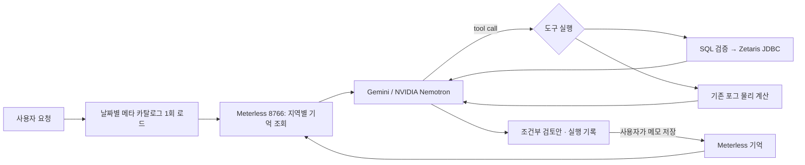

# Cool Sydney

기본 **설치 후 열지도**는 주변 분석 지면을 붉은 기준 공기온도로, 포그 냉각 영역을 낮은 온도에 따라 파랗게 표현합니다. 기준은 CBD 기상 모델 또는 수동 입력값 하나이며, 거리별 온도를 측정한 지도가 아닙니다. 색 눈금은 기본적으로 `기준 − 2°C (파랑) ↔ 기준 (빨강)`이고 화면에서 조절할 수 있습니다. 색 눈금을 바꿔도 계산값은 바뀌지 않습니다. **설치 전**은 같은 붉은 기준, **냉각량**은 기존 0–5°C 파란 감소량 눈금을 사용합니다. 배경 마스크는 10 m 지면 표본을 캐시하고, 장비 주변 감소량은 2 m 표본으로 그립니다. 건물·수면 경계는 이 해상도에서 근사됩니다.

대표 장비는 **Filtertech FEC-MP003** 한 종류입니다. 지도 도구 막대의 **심기**로 연속 배치하고, **선택·온도** 또는 Esc로 배치를 끝낸 뒤 분사기를 선택해 **이동·삭제**합니다. 왼쪽 배치 목록에서도 선택할 수 있습니다. **전체 분사 ON/OFF**는 모든 배치 장비에 적용하며 OFF에서는 물 분사·공기 냉각량을 0으로 계산합니다. 첫 분사기를 놓으면 자동 확대합니다. 노즐과 안개 애니메이션은 실제 치수·입자 궤적을 재현한 CAD/CFD가 아닌 설명용 모형입니다.

확인된 장비 사양은 ㄱ자형, LED 조명, 노즐 10개, 노즐 구경 0.1 mm입니다. 구경은 분무 입경이 아닙니다. 출처: [필터테크 영문 카탈로그](https://filtertech.co.kr/wp-content/uploads/2025/01/%E2%98%85filtertech-cooling-fog-system-catalogNomination-form_English-version.pdf)의 장비 구성표 및 [FEC-MP003 상품 정보](https://water777.co.kr/goods/view?no=189465). 압력별 노즐 유량과 거리별 성능은 미확인으로 유지합니다. `노즐당 유량(L/min) × 10 × 60`으로 1대의 L/h를 계산하며 초기 0.020 L/min → 12 L/h는 시나리오 가정입니다. [키그린 카탈로그](https://www.key-green.com/wp-content/uploads/2022/03/%ED%82%A4%EA%B7%B8%EB%A6%B0_%EC%BF%A8%EB%A7%81%ED%8F%AC%EA%B7%B8.pdf)는 별도 업체의 설명 자료로, 그 온도 저감 홍보 수치를 FEC-MP003의 성능 상수로 사용하지 않습니다.

Zetaris 에이전트 연결은 아직 구현 전입니다. 현재 `integrations.js`의 `zetarisQuery`와 `zetaris-gis.js`는 REST SQL 요청, GIS Parquet 등록 및 집계 확인을 담당합니다. 에이전트를 붙일 때는 서버에서 `ZETARIS_REST_URL`, `ZETARIS_ORG_ID`, `ZETARIS_API_KEY`를 사용하며 설치 버전의 SQL 경로를 `ZETARIS_SQL_PATH`로 지정해야 합니다. 키는 브라우저나 모델 프롬프트로 전달하지 않습니다. 제안 흐름은 **사용자 요청 → AI 에이전트 → 정해진 조회 도구 → Zetaris → 물리 시뮬레이션 → 지도 배치안**입니다. 보행·수목·기상 테이블을 조회 도구에 연결하고 시뮬레이터를 서버에서도 호출할 수 있도록 한 뒤 도구 호출 루프를 추가해야 합니다. 현재 포그 계산과 배치는 브라우저에서 동작하며 Zetaris나 AI가 실행한 결과로 표시하지 않습니다. [Zetaris API 접근 안내](https://kbase.zetaris.com/knowledge/accessing-zetaris-using-api).

분사기 배치 후에는 해당 위치로 자동 확대하며, 지도 라벨과 **선택 위치** 카드에 `설치 전 → 설치 후 (감소량)`을 표시합니다. 배치 모드가 아닐 때 주변 지면을 클릭하면 해당 좌표의 같은 계산장을 조회합니다. 영향 반경 밖은 감소량 0이며, 기상이 없으면 수치를 만들지 않습니다. 이 값은 공기온도 추정으로, 바닥 표면온도나 체감온도가 아닙니다. 바닥 재질·복사·전도·젖음·분사 시간에 따른 표면온도 모델은 아직 포함하지 않습니다.

미스트 배치 비교는 왼쪽 **미스트 비교 켜기 → 지도에 1대 배치**에서 시작합니다. 오른쪽 **설치 전 / 설치 후 / 냉각량**으로 같은 위치를 비교하세요. 작은 효과 영역을 보려면 지도를 확대하세요. 현재 기상 연결이 없으면 **직접 입력한 가정**으로 기온·습도를 지정할 수 있습니다. 현재 기상은 Open-Meteo CBD 중심 모델값이며 거리별 온도 실측이 아닙니다. 과거 날짜를 선택한 상태에서는 현재 기상 기반 냉각 표시를 중지합니다. 새 정적 모듈 경로가 추가되어 기존 서버는 재시작해야 합니다.

미스트 모델은 단열 증발의 물·공기 질량 및 엔탈피 수지를 풀어 장비 근처 혼합 공기의 온도·습도를 계산합니다. 물이 증발하며 공기를 냉각하고 습도를 높이는 열수지는 [EnergyPlus 증발 냉각 문서](https://energyplus.readthedocs.io/en/stable/guides/engineering-reference/16.3-evaporative-coolers.html)를 따릅니다. 외기 10–50°C, 기압 101.325 kPa, 물 온도는 습구온도라고 가정합니다. 분사량, 증발 비율, 혼합 공기 유량은 사용자가 지정하며 초기값은 특정 장비의 인증 성능이 아닙니다. 포화 한계 이상의 물은 추가 냉각으로 계산하지 않습니다.

지도는 별도 가정인 `ΔT(r) = ΔT₀ × max(0, 1 − r/R)²`로 2 m 간격의 평면 분석 셀을 표시합니다. 반경 R은 직접 지정하며 풍향·풍속, 노즐 입경, 건물에 의한 유동, 일사 재가열을 푸는 CFD는 아닙니다. 겹치는 위치는 최대 감소량 하나를 사용합니다. 건물·수면의 형상은 표시 제외에만 쓰며 공기 차폐나 설치 가능성을 검증하지 않습니다. 냉각량 보기에서는 파란색 0–5°C, 전·후 열지도에서는 기준 기온 대비 조절 가능한 빨강–파랑 눈금을 사용하고 범위 밖 색은 포화됩니다. 비교 중 기존 파란 그림자·그늘 표본은 잠시 숨기며, 배치 최대 10대는 현재 탭에서만 유지됩니다. 실측 보정 및 최적 배치 자동 탐색은 아직 구현하지 않았습니다.

보행 센서의 `446회/시간`은 선택한 날짜·시각에 대응하는 시간 단위 통과 계수입니다. 중복 통과를 포함할 수 있어 고유한 사람 수나 체류 인원이 아닙니다. 원천 타임스탬프가 시간 구간의 시작인지 끝인지는 아직 확인되지 않았습니다.

실제 시드니 GIS와 CBD 보행망·수목·자동 보행 계수·과거 기상을 로컬 GeoParquet/Parquet에 저장하는 웹 대시보드입니다. 건물 그림자 개요와 두 보행 경로의 직사광 노출을 비교합니다. 첫 분석 범위는 Sydney CBD / Town Hall입니다.

## 실행

2025-12-19 폭염 시나리오의 기상을 수집하고 시작하려면 저장소 루트에서 실행합니다.

```bash
bash scripts/run_dashboard.sh --date 2025-12-19
```

[BOM의 2025년 보고서](https://www.bom.gov.au/climate/current/annual/nsw/sydney.shtml)에 따르면 Sydney Observatory Hill은 이 날 연중 최고 42.2°C를 기록했습니다. 이 일 최고 관측값과 Open-Meteo ERA5 시간별 격자값은 서로 다른 자료이며 동일한 최고값을 강제하지 않습니다. [자동 보행 계수 원천](https://data.nsw.gov.au/data/en/dataset/5-cityofsydney--automatic-hourly-pedestrian-count)은 2025년 6월 수집이 종료됐습니다. 이후 날짜에는 계수 Parquet를 스키마가 있는 빈 테이블로 저장하고 `unavailable-source-ended`로 표시합니다. 0명이나 1월 관측으로 대체하지 않습니다. 건물·수목·보행망은 현재 저장된 형상이며 2025-12-19 당시 형상의 복원은 아닙니다. 다운로드 실패 시 기존 검증된 묶음을 유지합니다.

현재 묶음의 **12개 Parquet를 Zetaris에 등록**하려면 Docker의 driver가 healthy인 상태에서 실행합니다. 로컬 JDK의 `javac`와 설치 ZIP에 포함된 JDBC jar를 사용하고, 로그인은 driver 컨테이너의 기존 관리자 환경변수를 사용합니다.

```bash
python3 scripts/register_zetaris.py
```

이 명령은 파일 해시와 버전을 확인하고 별도 `customer-data/shared/cool-sydney-registration/` 경로에 파일을 복사한 뒤, 버전별 `cool_sydney_<hash>` 파일 소스에 등록하고 12개 테이블의 SQL 행 수를 검증합니다. 기존 DB·볼륨은 삭제하지 않습니다. `--prepare-only`는 SQL만 준비합니다. 데이터/SQL 준비와 실제 등록 성공은 구분하며, 성공할 때만 `VERIFIED ... 12`가 표시됩니다. VDM 화면에서 Mart를 생성하고 이 테이블들을 추가하는 작업 및 대시보드의 조회 경로 전환은 별도입니다. 웹에서 관리자 비밀번호를 바꿨다면 컨테이너의 초기 자격증명으로 JDBC 로그인이 실패할 수 있습니다.

처음 실행할 때는 저장소 루트에서 아래 한 명령을 사용합니다. Python 환경 확인 → 건물 GIS → 2025-01-15 보행망·수목·계수·기상 수집 → Parquet 검증 → 웹서버 시작 순서로 실행합니다. Git에는 대용량 데이터가 포함되지 않으므로 최초 수집에는 인터넷 연결이 필요합니다.

```bash
bash scripts/run_dashboard.sh
```

완료 후 **http://127.0.0.1:8765**에 접속합니다. 서버 종료는 Ctrl+C입니다. 기존 검증된 자료는 재사용합니다. 건물 지도만 먼저 준비하려면 `bash scripts/run_dashboard.sh --map-only`, 다른 과거 날짜의 계수를 받으려면 `bash scripts/run_dashboard.sh --date 2025-01-16`을 사용합니다. 기본값은 자료가 있는 여름날이며 현재 날짜의 보행 계수로 표시하지 않습니다. 화면에서 경로 분석은 수집한 날짜를 선택하세요. 거리 기온 실측 CSV는 Git에 없으며 별도 수집 대상입니다.

현재 작업 공간의 Git 체크아웃은 `.publish/GENAI_WORKS_HACKATHON`입니다. 이 체크아웃에 자체 `.venv`가 없으면 상위 폴더의 준비된 Python 환경을 찾아 사용합니다. 바깥 `openAgent/cool-sydney`에는 이전 코드가 있으므로 최신 저장소의 실행 스크립트를 사용하세요.

프로젝트 루트에서 실행합니다. Node.js 22 이상과 프로젝트 Python 환경의 PyArrow가 필요합니다.

```bash
.venv/bin/python -m pip install -r cool-sydney/requirements.txt
bash scripts/start_cool_sydney.sh
```

브라우저에서 **http://127.0.0.1:8765**에 접속하면 GIS 수집이 자동으로 시작되고 타일 다운로드·Parquet 저장 진행이 표시됩니다. 첫 수집에는 서버의 인터넷 접근이 필요합니다. 실패하면 오류 원인을 확인하고 **지도 데이터 다시 가져오기**로 재시도합니다. 저장 후 재실행하면 외부 호출 없이 Parquet를 검증해서 읽습니다. HTML 파일을 직접 여는 방식은 지원하지 않습니다. 코드 수정 전에 실행한 서버가 남아 있다면 Ctrl+C로 종료한 뒤 다시 시작하세요.

건물 지도가 준비되면 **선택한 날짜의 CBD 자료 가져오기**를 누릅니다. 기본 날짜 `2025-01-15`는 자동 계수 자료가 존재하는 여름 하루입니다. 첫 수집은 OSM 원본 보행망, City of Sydney 수목·센서 지점·시간별 계수, Open-Meteo ERA5를 내려받아 보관하므로 몇 분 걸릴 수 있습니다. 지도에서 출발점과 도착점을 클릭하고 우회 허용 시간과 보행 프로필을 선택하면 최단시간 경로와 저노출 후보를 비교합니다. 같은 자료를 명령행에서 수집하려면 건물 GIS를 먼저 준비한 다음 실행합니다.

```bash
cd cool-sydney
npm run import:cbd -- 2025-01-15
```

**거리 기온 실측 레이어:** Western Sydney University의 [2023–24 여름 미기후 원자료](https://research-data.westernsydney.edu.au/published/9bc62c10d22a11efab80570ec596f9e9/)에서 `Stream1_Temperature_Sydney_20231209_20240306.csv`를 받아 `data/cool-sydney/raw/microclimate/`에 두고 아래 명령을 실행합니다. 다른 위치에 받았다면 CSV 절대 경로를 명령 끝에 전달합니다. 이 작업은 현재 시나리오 날짜와 별도로 선택할 수 있는 실측 기준일의 시간별 평균을 준비합니다. 데이터가 이미 준비된 작업공간에서는 재수집이 필요 없습니다.

```bash
cd cool-sydney
npm run import:microclimate
```

지도에서 **거리 기온 관측 지점**을 켜고 **기온 실측 기준일**을 고르면 선택한 시각의 측정 지점만 색과 °C로 표시합니다. 기본 기준일은 `2024-01-26`입니다. 시뮬레이터 날짜가 `2025-01-15`여도 실측 기준일은 그대로 유지되며 지도와 패널에 별도로 표시됩니다. 날짜를 합쳐 같은 날의 온도라고 해석하거나 측정하지 않은 거리로 기온을 보간하지 않습니다.

**현재 기상 시뮬레이션:** 서버가 [Open-Meteo 현재 기상 API](https://open-meteo.com/en/docs)의 CBD 중심 좌표(`-33.8665, 151.208`)를 조회해 2m 기온·체감온도·습도·구름량·강수·10m 바람을 표시합니다. 저장된 관찰 조건이 없으면 첫 화면은 시드니 현재 날짜·15분 단위 시각으로 열립니다. **지금 시각 보기**를 누르면 언제든 현재 시각과 태양·그림자를 다시 맞춥니다. 날짜나 타임라인을 수동으로 바꾸면 현재 기상 표현은 꺼집니다. **캔버스 기상 표현** 스위치로 현재 시각의 균일한 기온 색조, 구름, 비, 바람 이동을 끌 수 있습니다. 서버는 성공 응답을 10분 캐시하고 화면은 10분마다 다시 요청합니다. API 오류 또는 90분 이상 어긋난 값은 현재값으로 그리지 않습니다. 첫 호출과 정기 갱신에는 서버 인터넷 접근이 필요합니다.

Open-Meteo 현재 조건은 기상 모델 자료이며 현장 관측소의 실측이나 거리별 온도 지도는 아닙니다. 강수량은 API 응답의 이전 15분 합계이고 입자 효과는 이를 설명하는 시각 표현입니다. 구름 표현은 그림자 판정이나 경로 계산의 입력으로 사용하지 않습니다. 과거 거리 센서값은 별도의 실측 날짜를 선택해야 표시됩니다.

Zetaris가 설치된 환경에서는 아래 명령으로 공개 GIS 폴더의 읽기 전용 마운트를 적용하고 웹서버를 실행할 수 있습니다. 기존 driver/api 컨테이너가 재생성될 수 있으나 볼륨을 삭제하지 않습니다.

```bash
bash scripts/start_cool_sydney.sh --zetaris
```

Zetaris 웹 UI에서 API 키를 생성해 프로젝트 루트 `.env`의 `ZETARIS_API_KEY`, `ZETARIS_ORG_ID`, `ZETARIS_REST_URL`을 설정하고 앱을 재시작합니다. 화면의 **Zetaris → 등록 → 조회**로 가상 테이블 등록과 실제 SQL 응답을 확인합니다. Docker 레지스트리 로그인과 이 API 키는 별개입니다. 설치 버전에 따라 `ZETARIS_SQL_PATH`를 조정해야 할 수 있습니다.

## 데이터 흐름

```text
OpenFreeMap / OpenMapTiles / OpenStreetMap
  → Node 백엔드: 제한된 구역의 TileJSON + PBF 수집·캐시
  → 형상·높이·출처 정규화
  → PyArrow: 레이어별 GeoParquet 저장, 전체 행 재조회 검증
  ├→ 백엔드 Parquet 읽기 → Three.js 실제 지도
  ├→ GIS worker: 태양 위치 + 건물 그림자 → 실행 결과 JSON
  └→ Zetaris: 로컬 파일 가상 테이블 → 행 수·버전 검증·높이 집계 → 화면

OSM 원본 노드·웨이 + City of Sydney 수목/계수 + Open-Meteo ERA5
  → Node 수집기: 원본 JSON 캐시·품질 검사·버전 묶음
  → PyArrow: 보행 노드/엣지·수목·센서 GeoParquet, 계수/기상 Parquet
  ├→ Three.js: 보행망·입체 수관·센서별 시간당 계수
  ├→ CBD worker: 최단시간·저노출 후보, 건물/수목 경로 그림자
  └→ 화면: 원천·가정·관측/재분석 구분

Western Sydney University Stream 1 (2023-12-09–2024-03-06)
  → 10분 간격 공기 온도 CSV · 센서 좌표/거리명
  → CBD 지도 범위와 설치 상태 검사 · 시간별 평균(유효 10분값 4개 이상)
  → 독립된 실측 기준일 레이어 · 지점별 온도 표시

Open-Meteo Forecast API / current (시드니 CBD 중심 좌표)
  → Node 프록시: 현재값 시각·범위 검증, 10분 메모리 캐시
  → 현재 시각 모드: 기온 색조·구름·강수·풍향 애니메이션
  → 출처·유효 시각 표시; 과거 센서/그늘 수치에 혼합하지 않음
```

현재 지도 형상과 그림자 계산 입력은 **로컬 Parquet에서 읽습니다**. Zetaris는 같은 파일을 가상 테이블로 조회하고 집계 결과를 대시보드에 반환합니다. 지도 전체 형상을 Zetaris SQL을 통해 가져오는 구현은 아닙니다.

미기후 자료는 별도 버전의 로컬 JSON 묶음으로 읽습니다. 현재 가져온 CSV에서 지도 범위 내 유효 센서 **29곳**, 10분 시각 **12,816개**, 유효한 센서별 시간평균 **59,280행**을 검증했습니다. 이 값은 보통 지상 2.5–3m의 나무 설치 센서에서 측정한 **공기 온도**이며 포장면 온도나 모든 보행 구간의 온도가 아닙니다. CSV는 공식 자료 포털의 직접 다운로드가 이 환경에서 HTTP 403을 반환해 공개 CSV의 텍스트 프록시 사본으로 확보했습니다. 원본 바이트 해시와의 일치 여부는 확인되지 않았으며, 이 경로와 입력 해시는 묶음 manifest에 기록했습니다. [연구 보고서](https://www.cityofsydney.nsw.gov.au/research-reports/mapping-summer-microclimates)의 지점 좌표·기간과 비교했습니다.

지도는 높이를 가진 건물과 높이가 없는 건물의 낮은 평면 형상을 구분해 그립니다. 선택 시각의 태양 위치로 건물 그림자와 가정한 수관 그림자를 투영하고, 화면에서만 경계를 약 3m 부드럽게 표현합니다. 그늘 비율과 경로 노출의 기준 계산은 서버 값을 사용합니다. 나무는 수고와 가정한 수관 직경을 반영한 입체 모형입니다. 센서 4곳의 시간당 통과수는 위치별 원과 이름·수치, 우측 고정 눈금 막대로 표시합니다. 원 크기는 0–5,000회에 고정하며 그 이상은 최대 크기로 표시합니다. 시간 재생 중에는 해당 현지 시각의 관측값을 갱신하고, 자료 날짜가 다르거나 유효값이 없으면 미관측으로 표시합니다. 이 계수는 도로 전체에 보간하지 않고 경로 비용에도 사용하지 않습니다.

```text
data/cool-sydney/
  raw/openfreemap/               # 원본 TileJSON/PBF 캐시
  processed/current.json        # 현재 자료 버전·출처
  processed/ofm-<hash>/
    building.parquet
    transportation.parquet
    water.parquet
    landcover.parquet
    landuse.parquet
    poi.parquet
    manifest.json              # 행 수·파일 해시·재조회 검증
    zetaris-registration.json  # 성공한 등록 명령·SQL 검증 기록
  raw/cbd/{walk,trees,sites,counts,weather}/  # CBD 원본 JSON 캐시
  processed/bundles/current.json             # 검증된 CBD 묶음 포인터
  processed/bundles/cbd-<hash>/              # 4개 GeoParquet + 2개 Parquet + manifest
  raw/microclimate/Stream1_Temperature_...csv # WSU 공개 10분 기온 원자료
  processed/microclimate/current.json         # 실측 기온 묶음 포인터
  processed/microclimate/micro-<hash>/         # 시간평균 JSON + 출처·품질 manifest
  runs/<id>.json               # 날짜·태양·그늘 표본·데이터 버전
  memory.json                  # 출처·버전별 관찰 조건
```

형상은 WKB 및 JSON, 좌표는 경도·위도(OGC:CRS84)로 저장합니다. `height_m`, `min_height_m`, `height_method`, `source_url`, `source_tile`, `source_hash`, `collected_at`, `dataset_version`을 포함합니다. 파생·기본 높이를 실측 높이로 표시하지 않고, 누락 높이는 null로 남깁니다. 타일 경계의 조각 수를 실제 건물 수로 표시하지 않습니다. 데이터 파일과 인증정보는 Git에서 제외합니다.

Zetaris 컨테이너에서는 `processed/`가 `/home/zetaris/customer-data/shared/cool-sydney`로 보입니다. 버전마다 별도 데이터베이스를 생성하므로 기존 자료를 덮어쓰지 않습니다. 여러 Spark 워커를 쓰는 배포에서는 모든 워커에 같은 경로가 보여야 합니다. 현재 번들의 local Spark 구성에 맞춘 마운트입니다.

## CBD 분석 계약과 구현 범위

`GET /api/gis/datasets`는 현재 묶음과 자료별 출처·행 수·품질을 반환합니다. `GET /api/gis/layers`는 지도에 필요한 보행 선형·수목·센서 지점을 반환합니다. `GET /api/gis/observations?instant=<UTC ISO>`는 선택 시간의 실제 자동 계수와 ERA5 재분석 값을 구분해 반환합니다. `POST /api/gis/routes`는 출발·도착 경위도, UTC 출발 시각, `standard`/`step_free` 프로필과 `max_detour_minutes`를 받습니다. 결과는 `GET /api/runs/<id>`로 다시 읽을 수 있습니다.

`GET /api/gis/microclimate/metadata`는 독립된 실측 기간과 출처를 반환합니다. `GET /api/gis/microclimate?date=2024-01-26&hour=14`는 선택한 **원자료 날짜·AEDT 시각**에 유효한 센서별 시간평균을 반환합니다. 같은 화면의 시뮬레이터 날짜·그림자·경로 계산에는 이 과거 기온을 대입하지 않습니다.

`GET /api/weather/current`는 서버가 검증한 Open-Meteo 현재 모델값, 현지/UTC 유효 시각, 가져온 시각, 기상 격자 좌표와 출처를 반환합니다. 시뮬레이터는 현재 시각일 때만 이 값으로 캔버스 대기 효과를 켭니다.

보행 연결은 OSM 웨이의 공유 노드와 층위/다리/터널 태그를 따릅니다. 차도 중심선만 있는 구간은 보도 위치 미확인으로 표시하고 노출 시간을 `unknown_minutes`에 둡니다. `step_free`는 계단을 제외한 **후보** 구간이며 현장 검증을 거친 무장애 경로가 아닙니다. 저노출 경로는 여러 가중치로 탐색한 후보 중 우회 한도 안에서 고른 결과로, 전역 최적을 보장하지 않습니다. 경로는 약 4m 간격으로 표본화하고 출발 뒤 경과 시간에 따라 태양 위치를 갱신합니다.

`TreeCanopyNS`를 m 단위 원형 수관 직경으로 해석하는 값과 수관 하단을 수고의 35%로 두는 값은 **가정**입니다. 원본 단위가 문서로 확인되지 않았으므로 실측 그늘로 설명하면 안 됩니다. Open-Meteo 값은 재분석 격자 자료이고 단거리 기온 관측이 아닙니다. 자동 계수 `Date`는 원천의 `Hour`와 일중 통행 패턴에 근거해 Sydney 현지 벽시계로 해석하고 UTC로 변환합니다. 서머타임 전환일은 원천 시각의 중복 여부를 식별할 수 없어 가져오지 않습니다. A004의 알려진 과소계수 기간은 수치를 관측값으로 표시하지 않습니다. 통행 횟수는 고유 보행자 수나 쉼터 수요가 아닙니다.

| 구성 | 구현 | 실제 서비스 검증 |
| --- | --- | --- |
| GIS + Parquet | PBF 디코딩, 출처·해시, GeoParquet 쓰기/재조회, 캐시 | 저장된 실제 타일을 로컬 Parquet에서 재조회 |
| CBD 4종 | 실제 OSM·City of Sydney·ERA5 수집, 6개 Parquet 검증, 자료 묶음 포인터 | 2025-01-15: 보행 엣지 23,839·수목 7,887·계수 96·기상 24행 |
| 3D 지도 | Three.js 건물·보행망·수목·센서·경로 표시 | headless Chrome에서 화면과 지도 클릭 흐름 확인 |
| 그림자 | 20m 건물 그늘 개요 및 약 4m 경로 표본의 건물·가정 기반 수관 그림자 | 고정 입력 테스트, 실제 경로 워커·브라우저 실행 통과 |
| Zetaris | 읽기 전용 마운트, 등록 SQL, 재시도 기록, 버전/행 수 확인, 높이 집계 | Docker 소켓 접근 차단, API 키 미설정으로 라이브 검증 전 |
| NVIDIA Nemotron | 사용자 요청에 따른 결과 설명, 실행당 4회 제한, 성공 응답 캐시 | API 키 설정 및 실제 응답 확인 필요 |
| Meterless H-MEM | 출처·버전·supersession·audit를 구현한 로컬 부분 구현 | 전체 엔진 통합 아님 |

기존 합성 인구·쉼터 최적화 코드는 단위 테스트용으로 남아 있으며, 기본 GIS 화면에서는 사용하지 않습니다. NSW 공개 수관 피복 교차 확인, BOM 최근 관측, 정기 보행 조사, Zetaris의 새 CBD 테이블 등록, 수목 치수 단위·현장 접근성 검증은 후속 작업입니다. 거리별 온도 예측이나 쉼터 최적 배치 결과는 제공하지 않습니다. 거리 계산은 Town Hall 중심의 국지 평면 근사이며 EPSG:7856 전환은 후속 작업입니다. 지도 파생 건물 높이·평지·자료 경계의 불확실성이 있습니다.

## 검증

```bash
cd cool-sydney
npm test
```

30개 테스트가 통과했습니다. CBD 테스트는 현지 시각 정규화, 층위별 보행 연결, 수관 광선, 실제 PyArrow 왕복과 해시 손상 거부를 확인합니다. 2025-01-15 실자료 수집과 화면 클릭을 통한 경로 비교도 별도로 확인했습니다. Zetaris와 NVIDIA는 모의 HTTP 응답으로 계약을 검사하며 실제 인증 성공을 의미하지 않습니다.

## 출처와 라이선스

- [OpenFreeMap 수집·캐시 지침](https://openfreemap.org/quick_start/): 고정된 작은 구역만 순차 수집하고 원본을 캐시합니다.
- [OpenMapTiles 스키마](https://openmaptiles.org/docs/schema/): 건물 높이는 지도용 파생값입니다.
- [OpenStreetMap ODbL](https://www.openstreetmap.org/copyright): 지도에 출처를 표시합니다.
- [GeoParquet 1.1](https://geoparquet.org/releases/v1.1.0/): WKB 및 CRS 메타데이터 형식.
- [City of Sydney 수목](https://services1.arcgis.com/cNVyNtjGVZybOQWZ/ArcGIS/rest/services/Trees/FeatureServer/0), [자동 계수 지점](https://services1.arcgis.com/cNVyNtjGVZybOQWZ/arcgis/rest/services/Automatic_Walking_Count_Sites/FeatureServer/0), [시간별 계수](https://services1.arcgis.com/cNVyNtjGVZybOQWZ/ArcGIS/rest/services/Automatic_Hourly_Pedestrian_Count/FeatureServer/0): 실제 수집 서비스.
- [Open-Meteo 과거 기상 API](https://open-meteo.com/en/docs/historical-weather-api), [이용 조건](https://open-meteo.com/en/terms): ERA5 시간별 재분석. 자료는 CC BY 4.0이며 무료 API는 비상업적 사용 조건입니다.
- [Zetaris 로컬 파일 연결](https://kbase.zetaris.com/knowledge/sql-manual), [Parquet 등록 예](https://kbase.zetaris.com/knowledge/how-to-connect-to-minio-s3): 로컬 경로로 적용한 등록 SQL은 화면에서 확인할 수 있습니다.

`vendor/scene-vendor.mjs`는 기존 EV platform의 Three.js 0.180.0, OrbitControls, mergeGeometries, @mapbox/vector-tile 2.0.4 및 pbf 4.0.1 번들을 재사용합니다. 라이선스는 같은 폴더에 보존했습니다. Python 의존성 버전은 `requirements.txt`에 고정했습니다.

## LangGraph 운영 검토 에이전트 — 2025-12-19

대시보드 오른쪽의 **LangGraph · 포그 운영 검토**에서 자연어로 요청합니다. 기존 설명 버튼과 별도의 에이전트이며, 실제 `@langchain/langgraph` StateGraph를 사용합니다.



### 실행

저장소 루트에서 실행합니다. 이미 다른 날짜 자료를 가져왔더라도 `--date`는 보관된 12월 19일 묶음을 선택하며 대시보드의 다른 날짜 자료를 덮어쓰지 않습니다.

```bash
npm --prefix cool-sydney install
python3 scripts/register_zetaris.py --date 2025-12-19 --with-catalog
```

두 번째 명령은 기존 12개 Parquet와 `agent_catalog` 메타 테이블을 등록·검증하고, SQL 조회용 Java 클래스를 driver에 복사합니다. JDK, Docker 접근과 정상 Zetaris driver가 필요합니다. `--prepare-only`를 붙이면 로컬 카탈로그와 등록 SQL만 생성합니다. 소스 데이터가 없는 다른 컴퓨터에서는 먼저 같은 날짜 자료를 수집해야 합니다.

저장소 `.env`에 다음 값을 설정합니다. 키는 Git이나 브라우저에 넣지 않습니다.

```dotenv
MODEL_PROVIDER=gemini
GEMINI_API_KEY=발급받은_Gemini_키
GEMINI_MODEL=gemini-3.8-flash
# NVIDIA를 선택할 때 사용하는 별도 설정
MODEL_BASE_URL=https://integrate.api.nvidia.com/v1
MODEL_API_KEY=발급받은_NVIDIA_키
NEMOTRON_MODEL=nvidia/nemotron-3-super-120b-a12b
METERLESS_BASE_URL=http://127.0.0.1:8766
ZETARIS_DRIVER_CONTAINER=zetaris-driver-1
```

Meterless는 별도 로컬 서비스입니다. 이 작업 공간에서는 `../../meterless-demo`에서 `npm start`로 실행합니다. 다른 환경에서는 해당 H-MEM HTTP 어댑터를 별도로 준비해야 합니다. LangGraph는 기존 `/api/search`와 `/api/memories`에 연결하며, 이 저장소가 8766 서버나 H-MEM 엔진을 복제하지 않습니다. 기억 서버가 꺼져 있으면 실행 기록에 `unavailable`을 남기고 기억 없이 진행합니다.

기존 대시보드를 종료한 다음, 저장소 루트에서 실행합니다.

```bash
node cool-sydney/server.js
```

접속: `http://127.0.0.1:8765/`. 에이전트 분석일과 지도 관찰일은 별도입니다. 이 버전의 에이전트는 지도 배치를 자동 변경하지 않습니다.

예시 요청:

> 2025년 12월 19일 10~18시 기온·습도를 조회하고 포그 5대의 운영을 검토해줘. 물 예산은 300L야. 보행 수요와 공간 자료가 부족한 부분도 알려줘.

### 메타 카탈로그와 도구

- `scripts/build_agent_catalog.py`: 실제 Parquet 스키마·행 수·컬럼 의미·단위·조인 키·시간 범위·결측·출처를 읽어 `data/cool-sydney/catalog/current.json`과 `agent_catalog.parquet` 생성. 메타 테이블은 컬럼당 한 행입니다. 에이전트는 동일한 JSON 캐시를 한 번 읽어 프롬프트에 전달하므로 테이블마다 DESCRIBE하지 않습니다.
- `execute_readonly_sql`: 모델이 현재 메타 정보에 맞춰 SQL을 작성합니다. 서버는 지정된 12개 테이블의 단일 SELECT만 실행합니다. 최대 3개 테이블·100행, 서브쿼리/CTE/파일 함수/UDF/쓰기 금지. JVM은 45초 query timeout을 요청하고 Node는 JDBC 프로세스를 60초로 제한합니다. 결과가 클 때는 집계를 요청합니다. Docker exec 종료가 모든 서버 측 작업의 취소를 보장하지는 않습니다.
- `simulate_fog`: SQL로 먼저 읽은 기온·습도만 받습니다. `SELECT instant_utc, temperature_c, humidity_pct FROM ...weather` 형태로 조회합니다. 기존 `mist-model.mjs`를 재사용해 소스 공기 냉각과 물 사용량을 계산합니다. 기본 가정은 노즐당 0.02 L/min, 증발 비율 0.7, 공기 유량 3 m³/s. 5대 × 8시간이면 480L이므로 300L 예산을 넘습니다. 이 값은 장비 실측 유량이 아닙니다.
- 모델 최대 6회, 호출당 60초, 전체 5분 제한. 도구 오류는 모델에 반환해 제한 내에서 수정하게 합니다. 모델 요청은 사용자 버튼 클릭 때만 발생합니다. 공급자는 Gemini와 NVIDIA 중 선택할 수 있습니다.
- 기억에는 지역 prefix와 run ID·출처가 붙습니다. 사용자가 입력한 조건·피드백만 저장하고, 답변을 실측 사실로 자동 저장하지 않습니다. 최근 지역 기억 최대 12개를 원문 검색합니다. 운영 조건 기억 체크 시 구조화한 장비 수·출퇴근 우선·물 예산을 저장하고 다음 요청으로 갱신합니다. 범용적인 의미 검색·충돌 해결 기능은 없습니다.

실행 기록은 `data/cool-sydney/agent-runs/<run-id>.json`에 저장합니다. 카탈로그 버전, 기억 ID/출처, SQL, 결과, 계산 가정, 모델 사용량, 도구 오류와 최종 답변을 같은 run에서 확인합니다. 모델 내부 reasoning이나 API 키를 기록하지 않습니다. 서버 재시작 중이던 실행은 실패로 표시하며 중간 노드에서 재개하는 체크포인터는 아직 없습니다.

API: `GET /api/agent/status`, `GET /api/agent/catalog`, `POST /api/agent/runs` (`question`, `date`), `GET /api/agent/runs/:id`, `POST /api/agent/runs/:id/memory` (`text`). 오래된 대시보드의 Zetaris REST 등록/조회 버튼과 이 에이전트의 Docker JDBC 연결은 서로 다른 경로입니다.

### 12월 19일 자료의 빈 곳

2025-12-19 묶음 `cbd-7d1748523f2f7087`, GIS `ofm-a2106753778c5141`의 검사 결과입니다.

| 자료 | 확인 결과 | 판단 시 제약 |
|---|---|---|
| 기상 | Sydney 00~23시 24행, 중복·시간 공백·null 없음 | ERA5 격자 공기 온도. 거리별/지면 실측 아님. 과거 테이블에 풍향 없음 |
| 보행량 | 0행 | 수집 종료 이후로 미관측. 0명으로 해석 금지. 아래 별도 예측 Parquet 제공 |
| 건물 | 626개 형상 조각 중 높이 7건 누락 | 나머지도 지도 파생/기본 높이이며 실측 보장 없음 |
| 수목 | 23,496건 중 수관 직경 35건 누락 | 나머지 23,461건도 원본 단위를 m로 가정한 원형 수관 |
| 보행망 | 62,952개 연결 중 20,169개 차도 중심선 | 실제 보도 위치 미검증 |
| 계수 지점 | 4곳 모두 최근접 도로 매칭 | 매칭 연결의 현장 검증 없음 |
| 공간 자료 시점 | 2026년에 수집한 형상·수목·보행망 | 2025-12-19 당시 도시 상태의 복원 자료 아님 |

도로·물·토지피복 등의 공통 스키마에 있는 null 높이는 해당 레이어에서 사용하지 않는 필드입니다. 보행 예측은 아래 후속 구현에 추가했습니다. 위치 최적화·실제 장비 제어는 별도 작업입니다. 지금 구현한 것은 데이터 조회, 물리 계산, 제약과 누락 근거를 설명하는 검토 루프입니다.

### 에이전트 검증

```bash
node --test cool-sydney/tests/agent.test.js
python3 -m unittest discover -s scripts/tests
```

테스트는 외부 API를 모의 응답으로 대체합니다. LangGraph 패키지가 없으면 실제 그래프 순환 테스트는 명시적으로 skip됩니다. 패키지 설치 이후 실제 LangGraph 순환과 기억을 통한 조건 변경 테스트도 통과했습니다. Gemini·NVIDIA 키와 Docker 소켓 접근은 없어 실제 외부 모델·DB 호출은 검증하지 못했습니다. 이 상태를 설정 완료 또는 서비스 연결 성공으로 표시하지 않습니다.

참고: [LangGraph Graph API](https://docs.langchain.com/oss/javascript/langgraph/graph-api), [NVIDIA Nemotron API](https://docs.api.nvidia.com/nim/reference/nvidia-nemotron-3-super-120b-a12b).

## 보행량 예측·Gemini·운영 조건 변경

### 현재 저장된 실제 학습 결과

자동 계수 과거 원본 **188,376건**, 중복 지점·시간을 정리한 **188,372행**을 읽었습니다. 수집 기간은 2020-02-01~2025-06-30입니다. 학습에서는 2022년 이전, DST 전환일, A004 알려진 과소계수, 같은 지점·시간 중복, 24시간 전체가 0인 의심 일자를 제외합니다. 의심 일자 제외는 모델링 가정이며 원본은 삭제하지 않습니다. 시간 결측을 0으로 채우지 않습니다.

두 통계 모델을 비교합니다.

- 기준 모델: 지점별 최근 8주 같은 요일·시간 평균. 미래의 실제 전날·전주 값은 사용하지 않습니다.
- 후보 모델: 최근 2년의 요일·시간·월·12월 구간 평균을 계층적으로 평활하고, 최근 8주의 수준 변화로 보정합니다. 시간에 따라 관측 가중치를 줄입니다.

2023-06-30까지만 학습해 2023년 12월 1~14일 오차로 모델을 선택하고, 12월 15~31일 별도 구간에서 불확실성 폭을 보정합니다. 이후 모델 종류와 보정값을 고정한 채 2024-06-30까지 학습하여 2024년 12월을 평가합니다. 무작위 분할이나 2025년 12월 관측값 사용은 없습니다.

**선택된 모델은 최근 8주 기준 모델**입니다. 계절 보정 후보가 선택 구간에서 이를 개선하지 못했습니다. 2024년 12월 독립 테스트 2,976행에서 MAE 261.8회/시간, WAPE 25.5%, 90% 목표 구간의 경험적 포함률 92.2%입니다. 평균 구간 폭은 약 1,100회/시간으로 넓습니다. 이 숫자를 2025년 12월 정확도로 설명하면 안 됩니다. 현재 모델은 폭염·기상·특별 행사·명시적 공휴일 효과를 학습하지 않습니다.

최종 학습 컷오프는 2025-06-30, 대상 날짜는 2025-12-19로 172일 앞을 예측합니다. 4지점 × 24시간 = 96행을 관측과 별도로 저장했습니다.

```bash
# 원본 수집: 월별 캐시, 페이지 수·중복 ID·원천 행 수 검증
python3 scripts/fetch_pedestrian_history.py
# PyArrow가 있는 프로젝트/상위 .venv를 자동으로 찾아 학습
python3 scripts/train_pedestrian_forecast.py --date 2025-12-19
# 예측 테이블까지 Zetaris에 등록하려면
python3 scripts/register_zetaris.py --date 2025-12-19 --with-forecasts --with-catalog
```

결과 경로: `data/cool-sydney/processed/pedestrian-forecasts/ped-*/`.

- `pedestrian_history.parquet`: 정규화한 이력과 제외 품질 표지
- `pedestrian_forecasts.parquet`: `site_id`, `instant_utc`, `predicted_passages`, `lower90`, `upper90`, `model_id`, `training_cutoff`, `evidence_type=forecast`
- `forecast_backtest.parquet`, `evaluation.json`: 독립 검증 예측·실제값·오차
- `model.json`: 학습된 평균·가중치·보정값·원본 해시

백엔드는 Parquet를 검증 후 읽고 버전별로 캐시합니다. `GET /api/pedestrian/forecast?date=2025-12-19`로 확인할 수 있습니다. 지도에서는 미관측 지점에만 보라색 **예측** 표시와 구간을 추가하며, 원본 `counts`를 덮어쓰지 않습니다. **분석일 지도·예측 보기** 버튼은 보관된 12월 19일 자료를 읽습니다. 대시보드의 최근 수집 날짜를 다른 날로 바꿔도 이 분석일 자료는 유지됩니다.

### Gemini와 후속 요청

Google [공식 OpenAI 호환 API](https://ai.google.dev/gemini-api/docs/openai)에 연결합니다. `.env`의 `GEMINI_API_KEY`는 [Google AI Studio](https://aistudio.google.com/apikey)에서 발급받은 값을 넣습니다. 기본 모델은 `gemini-3.8-flash`이며 `GEMINI_MODEL`로 변경 가능합니다. NVIDIA 키와 Gemini 키는 서로 공유하지 않습니다. 패키지 설치와 그래프 테스트는 완료했지만 실제 Gemini 호출은 API 키를 넣은 뒤 확인해야 합니다.

1. “포그 50대가 있어. Martin Place, QVB, Park Street에 배분해줘.”
2. “출퇴근 시간을 고려해줘.” → 50대 유지, 출퇴근 가중치 변경
3. “이번에는 30대로 바꿔.” → 수량만 30대로 변경, 출퇴근 조건 유지

장비 수는 고정 상수가 아닙니다. 자연어 숫자 또는 장비 수 입력칸의 0~10,000 정수를 적용합니다. 복잡한 문장에 서로 다른 수량이 여러 개 있으면 임의로 총수를 고르지 않으므로 입력칸에 총수를 지정하세요. **운영 조건과 검토 배분을 Meterless에 기억**을 선택하면 사용자 조건과 계산된 검토 배분을 저장합니다. 기억 저장 실패도 화면에 표시합니다. 현재 명시한 값이 기억보다 우선합니다.

`allocate_fog`는 검증된 설치 최적화가 아니라 수요 비례 정수 배분 시나리오입니다. 구역별 예측 수요 점수에 비례해 최대 잔여 방식으로 배분하므로 합계가 요청 수량과 같습니다. 출퇴근 우선은 07~10시, 16~19시 가중치 2배 가정입니다. 물 예산이 있으면 지점당 12 L/h 가정으로 수요 점수가 높은 시간부터 분사 분량을 배정합니다. 공급·전원·보도 폭·그늘·장비 중복을 고려한 실제 위치 선정은 별도입니다.

**현재 구역 대리값은 미검증**입니다: Martin Place←Elizabeth Street, QVB←Market Street, Park Street←Park Street 센서 예측. 정기 보행 조사가 수집돼도 자동으로 이 매핑을 검증하거나 대체하지 않습니다. 조사 지점·측정 단위·날짜를 확인한 뒤 연결해야 합니다.

### 정기 보행 조사 수집

[City of Sydney 정기 조사](https://www.cityofsydney.nsw.gov.au/public-health-safety-programs/walking-counts)는 약 100곳, 매년 3월·10월의 평일·주말 조사일 06~24시 자료입니다. 자동 계수 4곳의 연속 관측과 별개의 출처입니다.

```bash
python3 scripts/fetch_walking_surveys.py
```

공식 ArcGIS 서비스 목록에서 정기 walking count 관련 FeatureServer를 찾아 지점·조사 관련 레이어와 테이블을 수집합니다. 원본은 `raw/walking-surveys/`, Parquet는 `processed/walking-surveys/survey-*/`에 저장합니다. 원천 필드와 단위를 보존하며 시간을 임의로 UTC로 바꾸거나 숫자를 다시 6배 하지 않습니다. 원천 메타데이터와 날짜 필드 범위를 manifest에 기록합니다. 2025-12-19 분석에 이후 조사 자료를 섞으면 안 됩니다. 현재 실제 조사 자료의 다운로드·컬럼 확인은 사용자 터미널 수집 완료 후 검증해야 합니다.

macOS Python의 기본 CA 파일이 없을 때 기존 `/etc/ssl/cert.pem`을 사용합니다. SSL 인증서·호스트명 검증을 끄지 않습니다. 필요하면 조직에서 제공한 인증서 묶음을 `SSL_CERT_FILE`로 지정할 수 있습니다.

## 저장된 Parquet를 Zetaris에 동기화

저장소 루트에서 다음 명령을 사용합니다.

```bash
python3 scripts/register_zetaris.py --date 2025-12-19 --sync
```

`--sync`는 지정 날짜의 기본 12개 테이블, 저장된 보행 예측·학습 이력·검증 결과, 다운로드가 끝난 정기 조사 Parquet, 메타 카탈로그를 하나의 등록 계획에 포함합니다. 현재 저장되지 않은 선택 자료는 `SKIP`으로 표시합니다. 정기 조사는 `survey_<원본 파일명>` 형태의 테이블로 등록하며 원천 컬럼 이름과 날짜 인코딩을 보존합니다. 조사 날짜·단위·조인 키는 아직 자동으로 검증되지 않았고, 분석일 이후 자료를 SQL에서 제외해야 합니다.

파일 체크섬 → 컨테이너 복사 → SQL 테이블 등록 → 모든 테이블 COUNT 검증 순서로 실행합니다. 모든 검증이 성공한 후에만 `catalog/current.json`을 새 데이터베이스로 전환합니다. 실패하거나 `--prepare-only`를 사용하면 기존 활성 카탈로그를 유지합니다. 새 데이터 버전은 별도 데이터베이스 이름을 사용하며 기존 테이블·볼륨을 삭제하지 않습니다. 메타 정의가 바뀐 경우에도 `--sync`는 새 등록 버전을 만듭니다.

준비만 확인하려면:

```bash
python3 scripts/register_zetaris.py --date 2025-12-19 --sync --prepare-only
```

등록 SQL, 계획, 후보 카탈로그는 `data/cool-sydney/zetaris-registration/<database>/`에 저장합니다. 성공한 등록에는 `verified.json`이 생깁니다. 에이전트는 다음 요청부터 검증된 카탈로그의 테이블과 컬럼을 사용합니다. SQL Workspace에서는 출력된 데이터베이스 이름으로 조회할 수 있습니다.

새 자료 저장 직후 등록까지 이어서 실행하려면:

```bash
python3 scripts/train_pedestrian_forecast.py --date 2025-12-19 --sync-zetaris
python3 scripts/fetch_walking_surveys.py --sync-zetaris --analysis-date 2025-12-19
```

Docker 접근 또는 등록 검증이 실패해도 이미 저장한 Parquet는 유지됩니다. 원인을 해결한 뒤 첫 번째 `register_zetaris.py --sync` 명령만 다시 실행하면 됩니다. 정기 조사 등록은 원천 자료를 SQL로 질의 가능하게 만드는 단계이며, 기존 구역 대리 배분 모델에 조사를 자동 적용하는 단계는 아닙니다.
