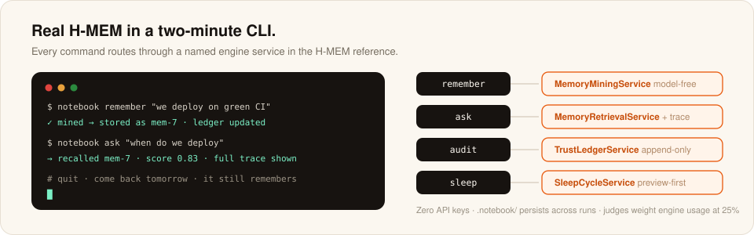

# Agentathon Starter: The Research Notebook Agent

## 로컬 웹 UI

기억 목록, 조건 저장·수정, 검색, 기억별·전체 변경 이력을 브라우저에서 확인할 수 있습니다. 공식 H-MEM 참조 엔진을 호출하며 CLI와 같은 `.notebook/` 데이터를 사용합니다. 기본 실행에는 API 키와 추가 패키지 설치가 필요하지 않습니다. Node.js 22.19 이상을 사용하세요.

```bash
cd /Users/suyeongkim/cs/openAgent/meterless-demo
npm start
```

브라우저에서 **http://127.0.0.1:8766**을 여세요. 기존 `mem-1`도 목록에 표시됩니다. 종료는 `Ctrl+C`, 포트가 사용 중이면 `PORT=8767 npm start`로 실행합니다.

- **기억 목록:** 기억을 선택하면 내용·출처·신뢰도·태그와 이력이 열립니다.
- **조건 저장:** ‘새 기억’에서 조건과 출처를 입력합니다. 기존 기억을 선택해 수정하면 이전 값과 변경 값이 이력에 남습니다.
- **검색:** ‘H-MEM 순위 검색’은 공식 참조 엔진의 해시 임베딩과 순위 공식을 사용합니다. 실제 언어 모델이나 의미 임베딩은 사용하지 않습니다. 한국어는 **원문 포함** 검색을 선택하세요. 이 방식은 UI 어댑터의 문자열 검색이며 조회 이력은 H-MEM에 남깁니다.
- **변경 이력:** 오른쪽 패널은 선택한 기억의 이력, ‘전체 이력’은 모든 기억의 생성·조회·변경 기록입니다.

기억은 새로고침과 서버 재시작 후에도 남습니다. CLI에서 변경한 내용은 ‘새로고침’으로 반영됩니다. 같은 기억의 오래된 화면에서 저장하면 덮어쓰기 대신 새로고침을 안내합니다. 참조 엔진의 JSON 저장소는 단일 사용자 데모용이므로 CLI와 UI에서 동시에 쓰지 마세요. 엔진을 새로 받는 환경에서는 아래 `npm run setup`을 먼저 실행합니다.

```bash
npm test
```

기존 기억 읽기, 수정 전후 이력, 재시작 후 복구, 영문 순위 검색·한국어 원문 검색, 잘못된 입력과 외부 요청 차단을 임시 저장소에서 검증합니다. 실제 `.notebook/`은 테스트로 변경하지 않습니다.

---

A CLI agent whose memory is real H-MEM: it mines what you tell it, ranks what it recalls, explains where every answer came from, and remembers across runs. Zero API keys. Your hackathon project starts by replacing the CLI with your own surface and keeping the memory spine.



## Two minutes to first recall

```bash
npx degit meterless/meterless/templates/agentathon-starter my-agent
cd my-agent
npm install
npm run setup        # REQUIRED: vendors the H-MEM reference into vendor/ (gitignored)

npx tsx notebook.ts seed
npx tsx notebook.ts ask "what did we decide about storage"
```

Step 4 is not skippable: `vendor/` is gitignored, so a fresh clone has no engine until setup runs. The startup line always names which engine source loaded.

Quit the terminal, come back tomorrow, ask again: it still remembers. That persistence (`.notebook/`, also gitignored) is the demo.

## Commands

```bash
npx tsx notebook.ts remember "We always deploy on green CI"
npx tsx notebook.ts ask "when do we deploy"
npx tsx notebook.ts audit mem-1        # the memory's append-only ledger history
npx tsx notebook.ts sleep --preview    # consolidation plan, nothing applied
```

## Where the engine is used (judges look here)

The rubric weights "Meterless engine usage" at 25%. Every command routes through a named H-MEM service; nothing is faked:

| Command | Engine service | Spec section |
|---|---|---|
| `remember` | MemoryMiningService (model-free path) + MemoryStoreService | AGENTS.md 4, 3 |
| `ask` | MemoryRetrievalService (hybrid formula, reinjection, trace) | AGENTS.md 6 |
| `audit` | TrustLedgerService (append-only history) | AGENTS.md 9 |
| `sleep` | SleepCycleService (preview-first, guardrails, backup) | AGENTS.md 8 |
| answer quality over time | feedback deltas are one call away: `hmem.feedback(id, "helpful")` | AGENTS.md 9.2 |

## Add a real model (optional)

The default answer mode is retrieval-only and fully offline. With a key:

```bash
npm install @anthropic-ai/sdk
ANTHROPIC_API_KEY=... npx tsx notebook.ts ask "what did we decide about storage"
```

The reinjected memory block goes into the prompt; the answer cites memory ids. Both modes are labeled in the output.

## Extension ideas by track

- **Memory agents**: extend mining with your own event types; wire `feedback` to thumbs up/down; build the dream review UI.
- **Desktop agents**: pair the notebook with Relay-style execution; memories become preconditions for actions.
- **Creative swarms**: when the swarm orchestration engine drops, fan out variants and remember which ones the user kept.
- **Enterprise workflow**: point `remember` at your CRM export; `ask` becomes account context on demand.

Rubric and tracks: [docs/community/hackathon-guide.md](../../docs/community/hackathon-guide.md). Engine spec: [engines/hmem/AGENTS.md](../../engines/hmem/AGENTS.md).
