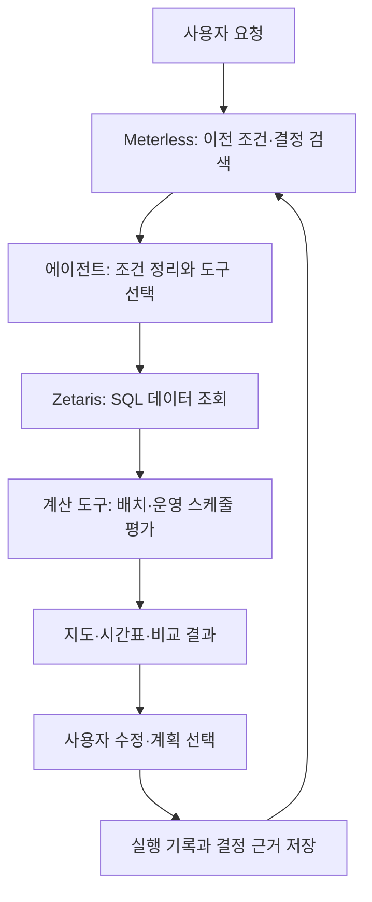

# Cool Sydney — 포그 운영 에이전트 데모 시나리오

작성일: 2026-10-27 · 예상 발표 시간: 약 5분

## 1. 데모의 목적

**한 번 계획을 만들고, 사용자의 수정을 기억한 뒤, 조건이 바뀌면 운영안을 다시 계산하는 과정**을 보여준다.

사용자는 도시 시설 운영자다. 에이전트는 포그를 어느 구역에 몇 대 배치하고, 몇 시부터 몇 시까지 운영할지 제안한다. 사용자가 지도를 보며 수정한 조건은 다음 대화에서도 이어진다.

이 문서는 **구현할 데모의 시나리오**다. 아래의 에이전트 응답은 예상 대사이며 실제 실행 결과가 아니다. 온도 감소량·물 사용량·운영 시간은 실행한 계산 결과로 채우고, 구현되지 않은 단계는 화면에서 준비 중으로 구분한다.

## 2. 배경과 데이터 조건

- 대상 지역: Sydney CBD의 Town Hall 주변.
- 분석일: **2025년 12월 19일**.
- 대표 장비: **Filtertech FEC-MP003**.
- 장비 수: 최대 5대.
- 운영 가능 시간: 시드니 현지 시각 **10:00~18:00**.
- 최초 물 예산: 하루 300L. 후속 요청에서 180L로 변경.
- 우선순위: 사용자가 지도에 지정한 광장과 보행 구역.

[BOM의 2025년 보고서](https://www.bom.gov.au/climate/current/annual/nsw/sydney.shtml)에 따르면 Sydney Observatory Hill은 2025년 12월 19일 연중 최고기온 42.2°C를 기록했다. 이 관측소의 일 최고기온과 시뮬레이션에 사용하는 ERA5 시간별 격자값은 구분한다.

해당 날짜의 자동 보행량은 없다. 원천의 자동 계수 수집은 [2025년 6월에 종료](https://data.nsw.gov.au/data/en/dataset/5-cityofsydney--automatic-hourly-pedestrian-count)됐다. 따라서 **사용자 지정 우선 구역**으로 대안을 평가하며, 이를 실제 혼잡도나 관측 수요로 표시하지 않는다. 빈 보행량 테이블은 0명을 의미하지 않는다.

건물·수목·보행망은 저장된 공간 스냅샷을 사용한다. 2025년 12월 19일 당시 도시 형상을 복원한 자료라고 설명하지 않는다. 포그 유량·증발률·유효 반경 등의 확인되지 않은 입력은 시나리오 가정으로 표시한다.

## 3. 역할 분담

| 구성 요소 | 역할 | 데모에서 확인할 증거 |
| --- | --- | --- |
| Zetaris | 등록된 Parquet와 분석 뷰를 SQL로 조회·결합 | 실행 SQL, 반환 행 수, 데이터 시점·버전 |
| 에이전트 | 요청 해석, 기억·데이터 조회, 계산 도구 호출, 대안 비교·설명 | 추출 조건, 도구 실행 상태, 선택 이유 |
| 계산 도구 | 그림자·포그 냉각·운영 시간별 물 사용량·후보 평가 | 입력값, 결과 ID, 제약 검사 결과 |
| Meterless H-MEM | 운영 조건, 제외 사유, 이전 결정과 피드백을 기억하고 검색 | 조회된 기억, 출처, 적용 범위, 이전 조건의 대체 관계 |
| 시뮬레이션 화면 | 지도·시간표·냉각 효과·계획 변경을 시각화 | 위치 변경, ON/OFF, 시간별 비교 |

자연어 질문마다 별도의 SQL 함수를 만들 필요는 없다. 에이전트에 스키마 조회와 읽기 전용 SQL 실행 도구를 제공하고, 에이전트가 필요한 SQL을 작성하도록 연결한다. 백엔드는 허용된 데이터 소스·조회 권한·쿼리 제한을 검사한다. 그림자·냉각·배치 평가는 별도 계산 도구가 담당한다.

## 4. 장면 1 — 최초 배치와 운영 계획

예상 시간: 0:00~1:20.

사용자가 입력한다.

> 2025년 12월 19일 Town Hall 주변에 포그 최대 5대를 배치해줘. 운영 가능 시간은 10시부터 18시까지이고, 하루 물 사용량은 300L 이내야. 지도에 표시한 광장과 보행 구역을 우선해줘.

| 단계 | 수행할 일 | 화면 표시 |
| --- | --- | --- |
| 요청 해석 | 날짜·구역·장비 수·물 예산·우선 구역 추출 | 조건 카드 |
| 기억 조회 | Meterless에서 기존 조건과 결정을 검색 | 관련 운영 기억 없음 |
| 데이터 조회 | 테이블 설명을 확인하고 Zetaris에 SQL 실행 | SQL과 반환 행 수, 자료 시점 |
| 후보 평가 | 후보 위치와 운영 시간 조합을 계산·비교 | 계산 상태와 후보별 결과 |
| 계획 제안 | 제약을 만족하는 후보안을 지도에 표시 | 포그 위치, 냉각 영역, 장비별 시간표 |

예상 응답:

> 물 예산 안에서 비교한 후보 중 이 배치안을 제안합니다. 장비별 운영 시간과 예상 물 사용량을 표시했습니다. 보행량은 미관측이므로 지정하신 우선 구역을 기준으로 평가했습니다.

이 장면은 조회와 계산을 거쳐 결정했다는 것을 보여준다. 후보 탐색 결과를 전역 최적해라고 보장하지 않는다. 조건을 만족하는 계획이 없으면 제약 위반을 숨기지 않고 실패 이유를 표시한다.

## 5. 장면 2 — 현장 판단을 반영한 수정

예상 시간: 1:20~2:10.

사용자가 포그 하나를 선택하고 지도에 출입구 제외 영역을 지정한다.

> 이 위치는 출입구라서 통행을 막아. 여기는 제외하고 다시 배치해줘.

에이전트는 해당 영역을 설치 후보에서 제외하고 다시 계산한다. 지도에는 변경 전 위치와 새 위치를 비교해 표시한다.

Meterless에 저장할 기억:

| 필드 | 내용 |
| --- | --- |
| 대상 | Town Hall 출입구의 사용자 지정 영역 |
| 조건 | 포그 설치 제외 |
| 이유 | 통행 방해 |
| 출처 | 사용자 지정 |
| 적용 범위 | 해당 프로젝트·지역·영역 |
| 유효 상태 | 사용자가 철회하거나 수정하기 전까지 유효 |
| 연결 기록 | 수정 요청 ID, 영역 형상, 변경된 계획 ID |

예상 응답:

> 출입구 제외 조건을 반영해 장비 위치를 변경했습니다. 운영 시간과 물 사용량도 다시 계산했습니다.

## 6. 장면 3 — 새 대화에서 기억을 활용

예상 시간: 2:10~3:30.

**새 대화**를 열어 이전 채팅 내용을 비운다. 프로젝트·지역 선택은 유지하되, 이전 요청 객체나 채팅 전문을 숨겨서 다시 전달하지 않는다. 기억은 저장된 Meterless 기록에서 조회해야 한다.

사용자가 입력한다. 출입구 제외 조건은 반복하지 않는다.

> 같은 날 같은 구역으로 다시 계획해줘. 이번에는 하루 물 사용량을 180L로 줄여줘.

| 단계 | 기대 동작 |
| --- | --- |
| 기억 검색 | 이전 분석일, 장비 수, 운영 시간, 우선 구역, 출입구 제외 조건 복원 |
| 범위 확인 | 현재 프로젝트·지역에 해당하는 유효한 기억인지 확인 |
| 조건 갱신 | 기존 300L 예산을 새 180L 예산으로 대체하고 변경 관계 기록 |
| 데이터 조회 | Zetaris에서 대상 날짜·지역의 자료와 버전 확인 |
| 재계산 | 새 물 예산과 기존 제외 조건으로 위치·운영 시간 재평가 |
| 결과 비교 | 이전 계획 대비 변경한 장비·운영 시간 구간 강조 |

예상 응답:

> 이전에 지정한 출입구 제외 조건과 우선 냉각 구역을 유지했습니다. 물 예산은 300L에서 180L로 변경하고, 운영 계획을 다시 계산했습니다.

이 장면에서는 **사용자가 반복 설명하지 않아도 이전 판단의 이유를 이어받는 것**을 보여준다. 기억에 일치하는 이전 계획이 여러 개면 적용 대상을 확인하며 임의의 날짜를 선택하지 않는다.

## 7. 장면 4 — 시간 재생과 계획 비교

예상 시간: 3:30~4:30.

사용자가 10:00~18:00 재생을 누른다. 화면에서 다음 항목이 같은 시각을 기준으로 움직인다.

- 건물·나무 그림자.
- 스케줄에 따른 장비별 분사 ON/OFF.
- 해당 시각의 과거 기온·습도를 적용한 예상 냉각 영역.
- 시간별·누적 예상 물 사용량.
- 이전 계획과 수정 계획의 차이.

| 비교 항목 | 최초 계획 | 수정 계획 |
| --- | --- | --- |
| 물 예산 | 300L | 180L |
| 예상 물 사용량 | 실제 계산 결과로 표시 | 실제 계산 결과로 표시 |
| 장비별 운영 시간 | 계산 결과 | 계산 결과 |
| 우선 구역의 냉각 효과 | 계산 결과 | 계산 결과 |
| 출입구 제외 조건 | 사용자 수정 후 반영 | 기억에서 복원해 반영 |

180L 계획의 냉각 효과는 줄어들 수 있다. 무조건 더 좋아졌다고 표현하지 않고 물 절약과 냉각 효과 사이의 차이를 설명한다. 온도는 현재 모델이 계산하는 공기 온도 변화이며 지면 표면 온도나 건강 피해 감소로 표현하지 않는다.

시간표는 장비가 지원하는 ON/OFF를 우선 사용한다. 분사 주기·강도 조절은 지원 사양이 확인된 경우에만 확장한다. 시간별 기상 사이의 보간이나 일정한 값 유지 규칙도 표시하고, 최신 기상 API 값을 과거 날짜의 기상으로 섞지 않는다.

## 8. 장면 5 — 선택한 결정을 다음 요청에 연결

예상 시간: 4:30~5:00.

사용자가 말한다.

> 이 수정안을 이번 시뮬레이션의 운영 계획으로 선택해줘.

배치·시간표·전체 계산 결과는 실행 기록으로 저장한다. Meterless에는 해당 기록의 ID와 함께 선택 이유, 적용 조건, 사용자 수정 사항을 기억시킨다. 시뮬레이션 결과와 현장 측정 결과는 서로 다른 증거 유형으로 저장한다.

계획을 선택해도 실제 장비를 제어한 것으로 표시하지 않는다. 실제 운영은 장비 제어 연결과 명령 실행 확인이 추가로 필요하다.

## 9. 화면 구성

| 위치 | 내용 |
| --- | --- |
| 왼쪽 | 대화, 요청 조건, 적용한 기억과 출처 |
| 가운데 | 지도, 포그 배치, 제외 영역, 시간 재생 |
| 오른쪽 | 장비별 시간표, 물 사용량, 냉각 효과, 변경 이유 |
| 하단의 근거 보기 | 실제 SQL, 데이터 시점·버전, 도구 실행 상태, 계산 결과 ID |

진행 상태는 `기억 조회 → 데이터 조회 → 후보 계산 → 제약 검사 → 계획 제안`으로 표시한다. 기록 화면에는 실제 실행한 단계만 완료로 표시한다.

## 10. 데모 준비 상태와 성공 기준

문서 작성 시 확인된 상태:

- 기존 기능: 지도, 그림자, 수동 포그 배치, 간이 냉각 계산, Parquet 저장·읽기.
- 사용자 실행 로그로 확인: `cool_sydney_908871e839b54e01`의 12개 테이블 등록과 SQL 행 수 검증 성공. 기상 24행, 보행량 0행.
- 추가 연결 필요: Zetaris 스키마 조회·읽기 전용 SQL 도구, Mart 구성, 에이전트의 자동 배치·시간표 계산, Meterless 운영 기억, 지도와 스케줄 연동.
- 실제 장비 제어는 이 데모의 범위 밖이다.

성공 기준:

1. 새 대화에서도 Meterless에서 출입구 제외 조건을 찾아 적용한다.
2. 기존 예산은 300L 기록으로 남기고, 새 계획에는 180L를 적용한다.
3. 실제 Zetaris 조회와 계산 결과를 근거로 배치·시간표를 제안한다.
4. 물 예산 위반, 보행량 결측, 데이터 날짜 차이를 숨기지 않는다.
5. 사용자 수정이 다음 결정에 반영되는 과정을 지도와 실행 기록에서 확인할 수 있다.

관련 문서: [현재 아키텍처](cool-sydney-architecture.md), [실행·데이터 등록 안내](../cool-sydney/README.md).
