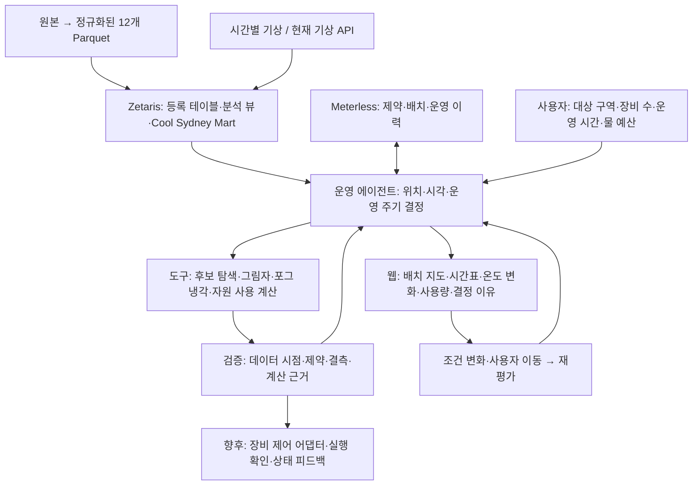
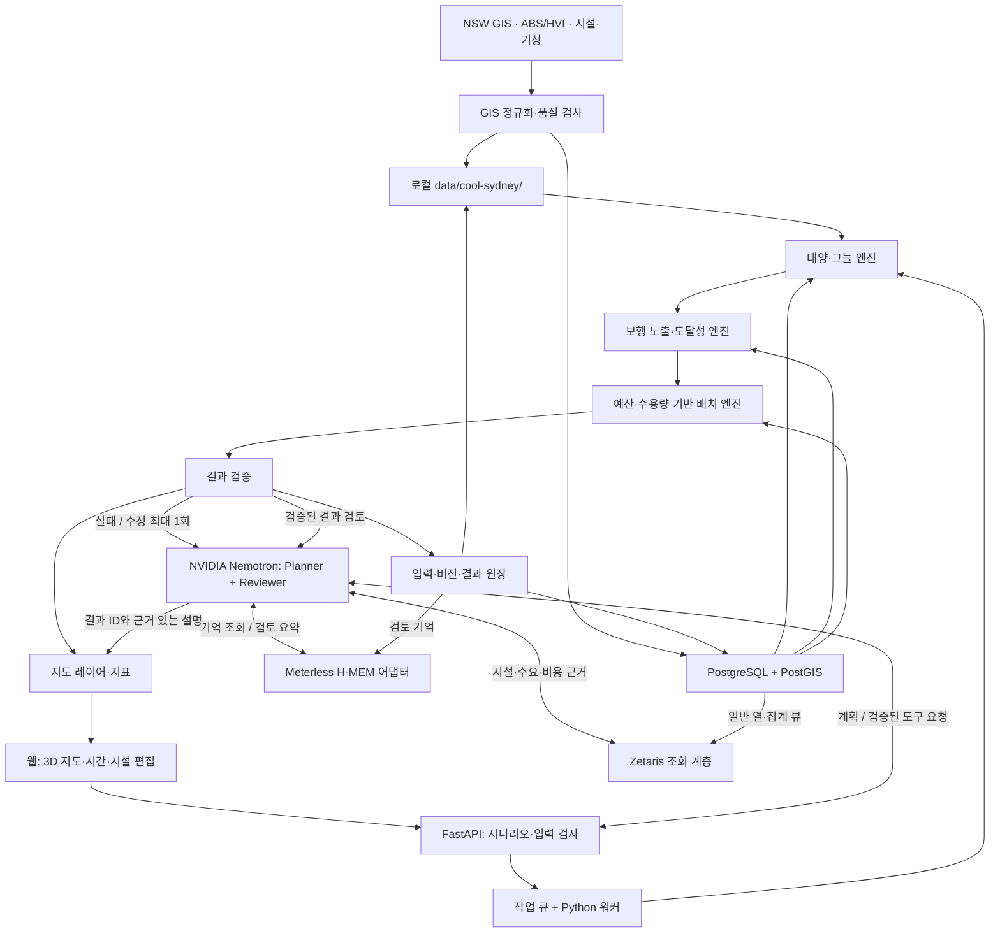
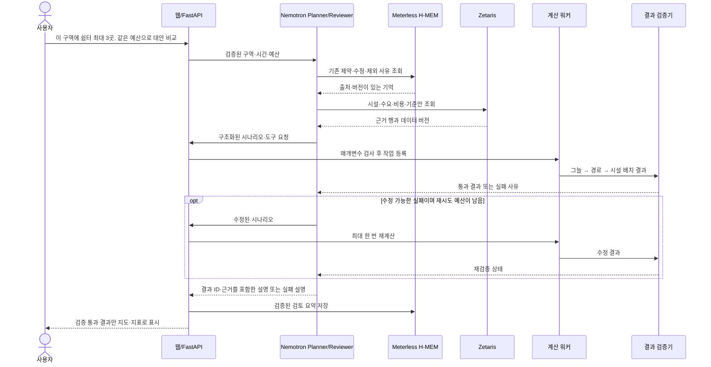
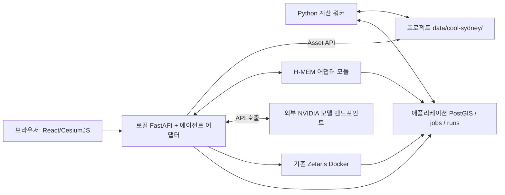

# Cool Sydney — 포그 배치와 시간별 운영 의사결정

2026-10-27 · 현재 제품 방향 · [HTML 구조도](cool-sydney-architecture.html)

에이전트는 **어느 지역에 몇 대를 배치하고, 몇 시부터 몇 시까지 어떤 분사 주기로 운영할지**를 결정합니다. 먼저 웹 시뮬레이션에서 실행 가능한 배치·운영안을 비교하며, 실제 장비 제어는 장비 API와 운영 한계 검증 이후 별도로 연결합니다. 아래는 목표 설계이며 자동 최적화·스케줄 제어의 구현 완료를 뜻하지 않습니다.



| 결정 | 입력과 처리 | 결과 |
| --- | --- | --- |
| 배치 계획 | 설치 가능한 후보, 보행 수요, 그늘, 기상, 장비 수·공급 조건을 비교 | 구역·장비 좌표·대수·대안 순위 |
| 운영 계획 | 시간별 조건과 물 예산, 장비가 지원하는 운전 모드를 비교 | 장비별 시작·종료 시각, ON/OFF, 지원되는 경우 분사 주기 |
| 운영 재평가 | 최신 데이터와 장비 상태 변화, 사용자 수정에 따라 재계산 | 유지·중단·재개·스케줄 수정과 이유 |

모델은 도구 호출과 결과 비교·설명을 담당하고, 온도 감소·그늘·물 사용량은 계산 코드가 산출합니다. 배치는 계획 단계의 결정이며 장비가 자동으로 물리적 이동을 한다는 뜻은 아닙니다. NVIDIA 모델은 도구 호출 가능한 후보를 실제 API 계약으로 검증해 선택합니다.

최적화 목표는 **물·운영 제약 안에서 열 노출을 줄이는 수요 가중 효과**입니다. 현재 보행 계수는 통과 횟수이므로 고유 수혜 인원이나 체류 시간을 계산했다고 표시하지 않습니다. 후보 탐색만 수행했다면 전역 최적해라고 표현하지 않습니다. 풍향·풍속은 향후 운영 제한과 확산 모델에 반영할 입력이며 현재 단순 방사형 냉각 모델이 바람을 계산한다고 주장하지 않습니다.

결정마다 `dataset_version`, `weather_time`, `demand_date`, `evidence_type`, 장비 설정, 좌표, 시간대, 운영 구간, 예상 냉각량·물 사용량, 계산 결과 ID와 이유를 저장합니다. 시간은 UTC로 저장하고 Australia/Sydney로 표시합니다. 입력이 없거나 오래되면 미관측·가정·보류 상태로 구분합니다. 장비별 최소 ON/OFF 시간·분사율·허용 환경 조건은 확인된 사양 또는 명시적인 시나리오 입력을 사용합니다.

현재 대표 분석일은 **2025-12-19**입니다. 기상은 해당 날짜 자료를 수집하고, 건물·수목·보행망은 저장된 공간 스냅샷을 사용합니다. 자동 보행 계수는 2025년 6월 수집 종료로 이날 자료가 없습니다. 따라서 보행 수요 기반 최적화는 별도 수요 가정 또는 대체 데이터 없이는 평가 완료로 표시할 수 없습니다. 과거 수요를 사용할 경우 원래 날짜와 가정임을 보존합니다.

현재 구현: 지도·그림자·수동 포그 배치·간이 냉각 계산, 로컬 Parquet 읽기, 현재 기상 API. 준비: 12개 Parquet JDBC 등록 스크립트. 미완료: 실제 Zetaris 등록 검증, UI VDM 구성, Mart 기반 대시보드 조회, 자동 배치·스케줄 결정, Meterless 전체 연동, 실제 장비 제어.

<details>
<summary>이전 냉방 쉼터 설계 — 참고용이며 현재 구현·제품 범위를 뜻하지 않음</summary>

2026-10-26 · 새 아이디어 기준 설계 · [인터랙티브 HTML 구조도](cool-sydney-architecture.html)

> 설계 문서입니다. 실제 GIS 수집, 웹앱, 계산 엔진, 스폰서 연동이 구현되었다는 뜻은 아닙니다.

## 1. 만들 제품

**시간에 따라 달라지는 도시의 그늘을 지도에 보여주고, 같은 예산으로 냉방 쉼터 접근 공백을 줄이는 배치를 비교합니다.**

사용자는 구역·날짜·시간을 선택하고, 쉼터 추가·운영시간 연장·차양 설치를 바꿔 봅니다. 화면은 건물·나무의 그늘, 쉼터까지의 보행 경로, 집단별 미충족 수요를 함께 표시합니다. AI는 사용자의 질문을 계산 요청으로 바꾸고 대안의 이유를 설명합니다.

첫 범위는 **Greater Sydney의 작은 구역 하나, 여름 하루, 기준안과 몇 가지 대안**입니다. 대상 구역은 실제 건물 높이·수관·보행망 확보 후 확정합니다. NSW 자료를 쓴다고 NSW 전역을 구현한 것으로 표현하지 않습니다.

그늘은 직사광 노출을 줄이는 요소입니다. 그늘이 있다는 이유로 냉방 수요를 0으로 만들거나 일정한 온도 감소량을 부여하지 않습니다. 첫 버전은 그늘·노출·접근성을 계산하며, 도시 기온 예측은 별도 열환경 모델과 검증이 필요한 확장입니다.

## 2. 전체 구조



데이터는 미리 수집·정규화합니다. 사용자 요청 때 모든 원천 API를 다시 호출하지 않습니다. 계산 워커는 PostGIS와 로컬 파일을 직접 읽고, 에이전트의 업무 근거 조회는 Zetaris를 거칩니다. 대용량 geometry를 모델 프롬프트에 넣지 않습니다.

## 3. Zetaris · Meterless · NVIDIA 역할

| 기술 | 실제 사용할 위치 | 데모에서 보여줄 증거 |
| --- | --- | --- |
| Zetaris | 시설·인구·비용·계산 요약을 일반 열 중심 뷰로 조회 | 실제 실행된 조회, 반환된 행, 데이터 버전 |
| Meterless H-MEM | 예산·접근성 제약·시설 제외 사유를 저장하고 다음 요청에서 재조회 | 첫 요청의 제약이 후속 요청에도 적용되는 저장·검색 기록 |
| NVIDIA Nemotron | Planner와 Reviewer: 시나리오 생성·도구 요청·대안 검토·설명 | 모델 호출, 구조화된 요청, 검증 실패에 따른 수정, 결과 근거 |
| Cursor | 개발 환경 | 개발·구현 과정 설명. 런타임 데이터 흐름에는 포함하지 않음 |

NVIDIA 모델 후보는 `nvidia/nemotron-3-super-120b-a12b`입니다. Planner와 Reviewer는 같은 모델을 별도 지시로 호출할 수 있습니다. 원격 추론을 제안하므로 Mac에서 모델 전체를 구동할 필요는 없습니다. API 이용 권한·키·요금·도구 호출 적합성은 구현 시 확인합니다. 무료 토큰이나 무제한 호출을 전제로 하지 않습니다.

H-MEM은 메모리 명세와 참조 구현을 제공하며, 완성된 운영 라이브러리를 바로 붙이는 방식으로 가정하지 않습니다. 이 설계는 이를 기반으로 한 어댑터 구현을 제안합니다. 정확한 실행 이력은 PostgreSQL에 남깁니다. 기억에는 출처·지역·시나리오·데이터 버전을 붙이고 오래된 제약을 최신 사실로 재사용하지 않습니다. 행사 요건 충족 여부는 HackOS의 Meterless 안내에서 확인해야 합니다.

참가 조건 근거: [FAQ](f_and_q.txt), [설계 가이드](solution_approach.txt). 현재 문서는 제품 구조를 정의하며 스폰서 연동 완료를 주장하지 않습니다.

## 4. 필요한 데이터

| 자료 | 필수 속성 | 쓰임 | 확보·검증할 사항 |
| --- | --- | --- | --- |
| 건물·지형 | 윤곽, 실제 지상 높이, DEM/DSM, 수직 기준 | 건물·지형 차폐 | 지역별 확보 필요. 계획상 허용 높이는 실제 높이를 대체하지 않음 |
| 나무 | 수관 범위, 높이, 형상, 투과율 | 시간별 나무 그늘 | 공개 수관 피복만으로 정확한 높이 추정 불가. 높이 확보 또는 가정 범위 필요 |
| 보행망 | 보도, 횡단보도, 계단, 경사, 시설 출입구 | 이동 시간·접근 가능 여부 | 한 구역을 선정해 연결성·보행 허용·출입구 확인 |
| 인구·취약성 | SA1 경계·인구, 집단별 통계, HVI | 취약 집단별 접근 공백 | HVI는 Greater Sydney 자료. 경계 연도·집단 중복 확인 |
| 시설 | 냉방, 운영시간, 수용량, 운영비, 접근성 | 실제 사용 가능한 쉼터 | 위치만으로 사용 가능 판정 금지. 미확인 값은 시나리오 가정 |
| 시간·기상 | 날짜, 시간대, 기온·습도·바람·일사 | 태양 위치·상황 조건 | 태양 계산과 기상 관측 구분. UTC 저장, Australia/Sydney 표시 |

공개 NSW 수관 피복 자료와 상세 수목 높이 자료의 접근 조건은 다릅니다. 높이를 얻지 못한 구역은 단순 형상·높이 범위로 민감도를 비교하고 가정임을 표시합니다. 정확한 나무 그림자로 제시하지 않습니다.

HVI는 Greater Sydney의 SA1 단위 복합 지수입니다. 실시간 온도나 개인별 위험으로 해석하지 않고, LGA 평균 HVI를 성과 지표로 쓰지 않습니다. HVI에 포함된 수관·인구 요인을 다시 합쳐 중복 가중하지 않습니다. SA1 인구를 보행망 출발점에 배분하는 규칙과 집단 중복 처리도 명시합니다.

전처리는 원본 해시·출처·기준일을 보존하고, 거리·면적에 맞는 투영좌표계 및 지상 높이/절대 고도 기준을 통일합니다. 분석 구역 밖 건물의 긴 그림자가 들어올 수 있으므로 경계 버퍼를 포함합니다.

## 5. 사용자의 한 번의 요청



시설이 닫혀 있으면 후보에서 제외하거나 운영시간 변경을 시나리오 가정으로 제안합니다. 모델이 임의로 실제 운영시간을 바꾸지 않습니다. 입력 부족·계산 실패는 실패 상태로 반환하고 성공 결과처럼 보여주지 않습니다.

## 6. 세 계산 엔진

| 엔진 | 처리 | 결과 |
| --- | --- | --- |
| 태양·그늘 | 위치·일시로 태양 방위/고도 계산 → 건물·지형·수관 차폐 계산 | 시간별 그늘 마스크, 그늘 지속시간 |
| 보행·노출 | 실제 보행망과 시설 입구 탐색 → 이동 중 시간별 그늘 겹침 | 이동 분, 직사광 노출 분, 도달 가능한 시설 |
| 시설 배치 | 후보 조합·운영시간을 예산·수용량 안에서 비교 | 중복 없는 수혜 추정, 집단별 미충족 수요, 비용 |

MVP는 작은 후보군의 조합을 전수 비교합니다. 규모가 커지면 정수계획 솔버로 바꿀 수 있습니다. 기본 목표는 수용 가능한 미충족 수요를 줄이는 것이며, 취약 집단별 결과를 별도로 보고합니다. 집단 가중치를 적용하면 정책 가정으로 공개하고 다른 가중치의 결과도 비교합니다.

15분 접근성은 직선 반경이 아닌 보행 시간입니다. 더 그늘진 길로 돌아가면 이동 시간이 늘 수 있으므로 노출 분과 이동 분을 함께 보여줍니다. 시설 간 중복 수요, 시간대별 수용량, 체류 시간 가정을 반영합니다. 추가 수혜가 0이면 추가 수혜자당 비용은 계산 불가로 표시합니다.

지도 렌더러의 시각적 그림자와 분석 엔진의 그늘은 같은 시간·형상을 사용하되 검증을 분리합니다. 나무 증산·바람·축열과 실내 온도까지 계산하는 열환경 시뮬레이션은 첫 버전 범위에 포함하지 않습니다.

## 7. 배포와 저장



AWS와 S3는 전제로 하지 않습니다. API·워커·애플리케이션 DB를 로컬에서 시작하고, Zetaris는 자체 Docker 구성으로 연결합니다. 처음에는 별도 Redis 없이 PostgreSQL 작업 테이블을 제안합니다. 워커가 원자적으로 작업을 가져가고 타임아웃·실패·중복 실행을 기록하도록 구현합니다.

```text
data/cool-sydney/
├── raw/             # 원본 GIS·시설·인구·기상
├── processed/       # 정규화 GIS·보행망·지도 자산
├── shadows/         # 구역·시간·형상·알고리즘 버전별 캐시
└── runs/            # 시나리오 입력·결과·가정·스냅샷
```

이는 제안 경로입니다. 데이터는 서버의 Asset API로 제공하고 원본·비밀키는 Git에서 제외합니다. 작은 재현 샘플과 출처 설명은 별도 추적합니다. 브라우저에 모델·Zetaris 인증 정보를 넣지 않습니다.

## 8. 구현할 API와 데이터 계약

아래 이름은 설계한 애플리케이션 API이며, 스폰서가 제공하는 API 경로가 아닙니다.

| API | 역할 |
| --- | --- |
| `POST /api/scenarios` | 구역·시간·예산·후보 시설·개입을 검증하고 scenario_id 생성 |
| `POST /api/scenarios/{id}/runs` | 작업 등록 후 job_id 반환 |
| `GET /api/jobs/{id}` | queued/running/succeeded/failed 상태와 단계별 진행 조회 |
| `GET /api/runs/{id}` | 기준안/대안 지표·출처·가정·검증 상태 반환 |
| `GET /api/assets/{asset_id}` | 허용된 지도·그늘 자산 제공 |
| `POST /api/scenarios/{id}/questions` | 후속 질문과 메모리 조회, 계산이 필요하면 새 작업 생성 |

공통 입력: `area_id`, `dataset_version`, `start_time`, `end_time`, `timezone`, `budget_aud`, `max_facilities`, `interventions`, `assumptions`.

공통 결과: `run_id`, `input_hash`, `solver_version`, `validation_status`, `metrics`, `asset_ids`, `sources`, `uncertainties`, `model_usage`.

캐시 키는 시간만으로 만들지 않습니다. 형상·수관·지형·해상도·알고리즘 버전까지 포함한 해시를 사용하고, 경로·배치 캐시는 시설·인구·개입 조건도 포함합니다. 비교할 대안은 공통 데이터 버전과 기준안을 공유합니다.

## 9. 구현 순서와 완료 기준

| 순서 | 구현 | 완료를 확인할 증거 |
| --- | --- | --- |
| 1. 구역·자료 확정 | 건물 높이·수관·보행망·시설·인구를 작은 범위로 수집 | 출처·형상·높이·경계 검사와 데이터 manifest |
| 2. 그늘 지도 | 날짜/시간 슬라이더와 서버 그늘 계산 | 독립 도구 또는 현장 근거와 몇 시점 비교 |
| 3. 접근성과 배치 | 기준안 + 시설 추가·운영 연장·차양 대안 | 보행 경로, 예산·수용량·중복 수요 검사 |
| 4. 스폰서 연결 | Zetaris 조회, H-MEM 저장/검색, Nemotron 계획/검토 | 실제 호출과 한 번의 제약 수정·재계산 기록 |
| 5. 재현 데모 | 지도·지표·설명 묶기, 샘플과 실행 절차 | 동일 입력의 계산 재현과 실패 사례 표시 |

모델 호출은 한 실행당 최대 4회, 수정·재계산은 최대 1회로 시작하는 설정을 제안합니다. 토큰·시간 제한을 두며 지도 이동과 시간 슬라이더 조작마다 모델을 호출하지 않습니다. 형상·시간별 계산은 캐시에서 읽습니다. 기준안·실측·가정·합성 샘플을 화면에서 구분합니다.

현재 문서 작성으로 완료되는 것은 설계와 구조도입니다. 실행 중인 Docker·API·데이터 확보 상태는 이 문서에서 새로 검증하지 않았습니다.

## 10. 구성 요소별 계약

### NSW · 공공 데이터

도시 형상, 주민 수요, 시설 공급을 서로 구분해 수집한다.

- 입력: 실제 건물 높이, 수관 형상, SA1 통계, 시설 운영 자료
- 출력: 출처·범위·기준일·라이선스가 있는 원본
- 구현 제안: NSW / ABS / 카운슬 자료 · 확보 가능한 한 구역부터

### GIS 수집 · 정규화

원본을 같은 공간·시간 기준으로 맞추고 분석 가능 여부를 검사한다.

- 입력: 원본 GIS·표, 분석 경계, 데이터 버전
- 출력: 정규화 형상, 보행 그래프, 시설·인구 테이블
- 구현 제안: Python · GeoPandas/GDAL · 지역 투영좌표계 · UTC 저장

### 프로젝트 로컬 저장소

대용량 GIS와 계산 자산을 현재 프로젝트 내부에 보관한다.

- 입력: GeoPackage, 래스터, 3D Tiles, 결과 파일
- 출력: 버전·해시가 있는 파일과 백엔드 자산 경로
- 구현 제안: raw / processed / shadows / runs · 공유 볼륨

### PostgreSQL + PostGIS

공간 질의와 관계 데이터를 관리하고 실행 결과를 재현한다.

- 입력: geometry, 시설 검증 상태, SA1 수요, 시나리오 입력
- 출력: 분석용 공간 데이터와 Zetaris 조회용 일반 열·집계 뷰
- 구현 제안: 별도 애플리케이션 DB · Zetaris 내부 DB와 분리

### 웹 · 도시 시뮬레이션

사용자가 구역·시간·예산을 바꾸고 그늘과 접근 공백을 비교한다.

- 입력: 지도 자산, 계산 지표, 출처 있는 설명
- 출력: 분석 요청과 시설·차양·운영시간 변경
- 구현 제안: React + TypeScript + CesiumJS · 작은 구역 우선

### FastAPI · 실행 조정

웹 요청을 검증하고 에이전트와 계산 작업을 연결한다.

- 입력: 구역, 날짜, 시간대, 예산, 후보 시설, 사용자 질문
- 출력: scenario_id, job_id, 실행 상태, 결과 URL
- 구현 제안: API 키는 서버에 보관 · 브라우저는 백엔드만 호출

### NVIDIA · Nemotron

사용자 목표를 매개변수로 바꾸고 계산 결과를 검토·설명한다.

- 입력: Zetaris 근거, H-MEM 제약, 검증된 계산 결과
- 출력: 구조화된 도구 요청, 제한된 수정 요청, 근거 있는 설명
- 구현 제안: 후보: nvidia/nemotron-3-super-120b-a12b · 원격 호출

### Meterless · H-MEM

반복 질문에서도 사용자 수정과 기존 제약을 유지한다.

- 입력: 사용자 제약, 검증 요약, 제외 시설 사유, 출처
- 출력: 지역·시나리오·버전이 맞는 관련 기억
- 구현 제안: 공개 명세·참조 구현 기반 어댑터 제안 · 별도 구현 필요

### Zetaris · 근거 조회

모델이 시설·인구·비용 근거를 일관된 질의로 조회하게 한다.

- 입력: 시설 ID, SA1 ID, scenario_id, 허용된 조회 조건
- 출력: 운영시간·비용·수요·결과와 데이터 출처
- 구현 제안: PostgreSQL 뷰 연결 · 공간 계산은 워커가 직접 수행

### 작업 큐 · 계산 워커

오래 걸리는 공간 계산을 API 요청과 분리한다.

- 입력: 시나리오 입력과 입력 해시, GIS 자산 버전
- 출력: 그늘·경로·배치 작업과 단계별 진행 상태
- 구현 제안: MVP: PostgreSQL jobs 테이블 + Python 워커 프로세스

### ① 태양 · 그늘 엔진

위치와 시간에 따라 직사광이 가려지는 영역을 계산한다.

- 입력: 실제 형상·지형, 날짜·좌표, 수관 투과 가정
- 출력: 시간별 그늘 마스크·그늘 지속시간
- 구현 제안: pvlib + 형상 투영/광선 추적 · 경계 버퍼 · 시간 캐시

### ② 노출 · 도달성 엔진

쉼터까지의 실제 보행 경로에 시간별 그늘을 겹친다.

- 입력: 보행망, 수요 출발점, 시설 입구, 그늘 시계열
- 출력: 이동 분, 직사 노출 분, 시설별 도달 가능 수요
- 구현 제안: PostGIS + Python 그래프 탐색 · 이동 중 시간 변화 반영

### ③ 쉼터 배치 엔진

같은 예산으로 접근 공백을 줄이는 시설 조합을 비교한다.

- 입력: 도달성 행렬, 집단별 수요, 운영비·시간·수용량
- 출력: 기준안/대안의 수혜 추정, 미충족 수요, 비용
- 구현 제안: 작은 후보군 전수 비교 → 필요 시 정수계획 솔버

### 검증 · 제한된 재계산

계산 조건 위반과 설명의 근거 누락을 드러낸다.

- 입력: 입력/결과 해시, 솔버 상태, 집단별 수요와 비용
- 출력: 통과 결과 또는 추가 자료·수정 요청
- 구현 제안: 수치 검증기 + Nemotron Reviewer · 재계산 최대 1회

### 지도 · 지표 · 설명

결과 ID가 같은 지도·수치·설명을 한 화면에 제공한다.

- 입력: 검증된 결과, 자산 URL, 가정과 근거
- 출력: 기준안/대안 지도와 비교표·내보내기
- 구현 제안: 시간 슬라이더는 계산 캐시 조회 · 매 프레임 AI 호출 없음

### 실행 이력 · 재현

동일 조건의 재실행과 비교가 가능하도록 기록한다.

- 입력: 시나리오, 데이터·솔버 버전, 계산 결과, 검토 요약
- 출력: PostgreSQL 원장 + 로컬 스냅샷 + H-MEM 검토 기억
- 구현 제안: 정확한 실행 기록은 DB · 관련 기억 검색은 H-MEM

## 11. 공식 근거

- [NSW HVI 2022](https://data.nsw.gov.au/data/dataset/2022-heat-vulnerability-index-for-the-greater-sydney-region) — Greater Sydney · SA1 단위 열 취약성 지수
- [NSW 수관 자료](https://planning.nsw.gov.au/the-planning-system/urban-greening/urban-heat-and-canopy-data) — 공개 수관 범위와 비공개 상세 높이 자료 구분
- [ABS Census](https://www.abs.gov.au/census/find-census-data) — 인구·가구 통계 및 공간 경계
- [City of Sydney Open Data](https://www.cityofsydney.nsw.gov.au/library-information-services/access-open-data) — 카운슬 데이터·다운로드·라이선스 확인
- [NSW Spatial Digital Twin](https://alpha.portal.spatial.nsw.gov.au/explorer/) — 건물·지형 자료 탐색 후보 · 재사용 가능 여부 확인 필요
- [Zetaris Getting Started](https://github.com/zetaris/getting-started) — 로컬 실행과 외부 데이터 조회 연결
- [Meterless H-MEM](https://github.com/Meterless/Meterless/tree/main/engines/hmem) — 메모리 명세·참조 구현 · 운영 통합 구현 필요
- [NVIDIA Nemotron 3 Super](https://build.nvidia.com/nvidia/nemotron-3-super-120b-a12b/modelcard) — 시나리오 계획·도구 호출·설명용 모델 후보
- [CesiumJS Viewer](https://cesium.com/learn/cesiumjs/ref-doc/Viewer.html) — 웹 3D 지도와 시간·그림자 표현
- [pvlib Solar Position](https://pvlib-python.readthedocs.io/en/stable/reference/generated/pvlib.solarposition.get_solarposition.html) — 위치·시간에 따른 태양 위치 계산

</details>
