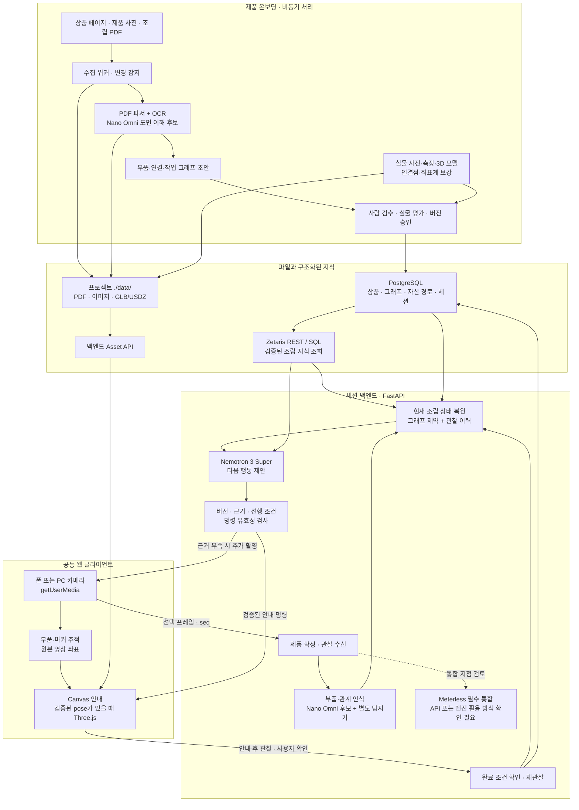
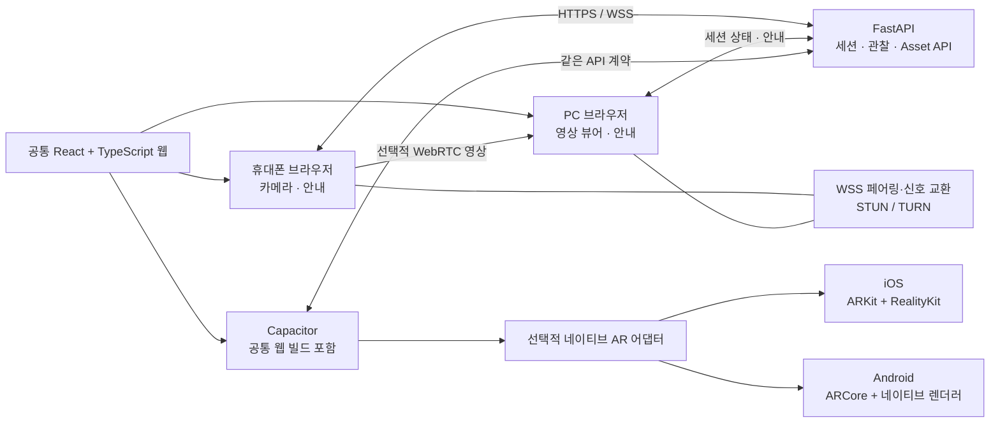
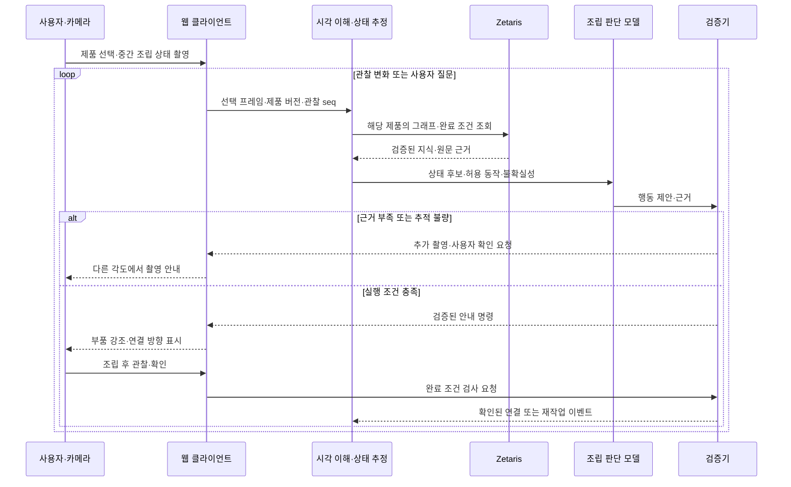

# IKEA AR 조립 시스템 아키텍처

웹 우선 설계 · 2026-10-16 · [인터랙티브 HTML](ikea-ar-architecture.html)

> 설계 문서입니다. 카메라 연결, AI 추론, 제품 수집, AR 앱은 아직 구현하지 않았습니다. 프로젝트에 로컬 `data/` 폴더 구조와 환경 점검용 스크립트가 준비되어 있습니다.

## 1. 목표와 구현 범위

사용자가 조립 도중 카메라를 켜면 현재 연결된 부품을 파악하고, 다음에 연결할 부품과 방향을 영상 위에 안내합니다. 사용자가 설명서의 현재 페이지를 직접 찾는 과정을 줄이는 것이 목표입니다.

- **전체 목표:** IKEA의 모든 조립 대상 제품을 담을 수 있는 카탈로그·문서·조립 지식 구조.
- **첫 구현:** 실물과 설명서가 있는 제품 1개, 첫 5~10개 동작, 중간 시작·오조립·가림 시나리오.
- **첫 클라이언트:** 휴대폰·PC에서 실행하는 반응형 웹.
- **이후 확장:** Capacitor로 iOS·Android 앱을 만들고 필요한 정밀 AR 기능을 네이티브로 추가.

자료를 확보한 제품 수와 실제 조립·AR 안내를 검증한 제품 수는 별도로 관리합니다.

## 2. 전체 구조



AI는 다음 행동을 제안합니다. 컴퓨터 비전과 추적기는 화면·실물의 위치를 계산하고, 검증기는 실행 가능한 안내인지 검사합니다. 언어 모델이 생성한 좌표를 그대로 정밀 AR 위치로 사용하지 않습니다.

Meterless는 새 참가자 TXT에서 필수 통합으로 명시되어 있습니다. 위 점선은 아직 API·엔진 지원을 확인하지 못한 통합 지점이며, 실제 연결을 완료했다는 뜻이 아닙니다.

## 3. 웹으로 시작하고 앱으로 확장

### 사용 모드

| 모드 | 사용 흐름 | 화면에 표시하는 위치 |
| --- | --- | --- |
| 폰 단독 | HTTPS 접속 → 제품 선택 → 후면 카메라 허용 → 조립 안내 | 폰의 카메라 영상 위 |
| 폰 + PC | PC 세션 생성 → 폰에서 QR 열기 → WebRTC 연결 | PC의 수신 영상 위, 필요하면 폰에도 안내 |
| PC 단독 | PC에 연결된 카메라로 촬영 | PC 웹 화면 |

폰 + PC 모드에서는 **촬영 폰이 분석할 프레임을 백엔드로 직접 전송**합니다. 전체 영상은 WebRTC로 PC에 보내고, 두 화면은 같은 세션의 안내·진행 상태를 구독합니다. 동일한 관찰을 폰과 PC가 중복 발행하지 않습니다.



### 카메라·렌더링 구현 경계

| 기능 | 웹 기본 구현 | 확장 방법 |
| --- | --- | --- |
| 카메라 | `getUserMedia`, `video`, 프레임 추출 | WebView 카메라 동작 검증 또는 네이티브 CameraSource |
| 화면 위 안내 | Canvas 2D로 부품 강조·방향·텍스트 표시 | 정렬 근거가 있는 경우 Three.js 3D 표시 |
| 부품 추적 | 특징점·마커·수동 초기 정렬, 별도 CV 추적기 | 제품별 pose 추정 모델 |
| 공간 고정 AR | 지원되는 브라우저에서만 WebXR | ARKit/ARCore와 네이티브 렌더러 |
| 앱 패키징 | 공통 웹 코드와 API 클라이언트 유지 | Capacitor, 앱 권한·복귀 처리, 플러그인 |

- Unity는 필수가 아닙니다.
- Three.js는 3D를 그리는 도구이며 공간 추적 기능은 별도로 필요합니다.
- WebXR는 `navigator.xr`와 `immersive-ar` 지원을 실행 시 확인하고, 미지원 시 Canvas 안내를 사용합니다.
- iOS Safari·Android 브라우저·앱 WebView가 같은 AR 기능을 제공한다고 가정하지 않습니다. PWA 설치나 Capacitor 패키징만으로 정밀 AR이 추가되지 않습니다.
- 네이티브 AR 모드에서는 카메라·추적·렌더링을 네이티브가 담당하고, 웹에는 안내 명령과 요약 상태를 전달합니다. 고빈도 영상 프레임을 모두 JavaScript 브리지로 왕복시키지 않습니다.

폰 카메라 사용에는 HTTPS와 사용자 권한이 필요합니다. 개발용 Mac에 폰을 연결할 때도 신뢰할 수 있는 HTTPS 주소를 준비합니다. 페어링은 짧은 수명의 일회용 코드로 연결하고, WSS signaling과 STUN/TURN을 구성합니다.

## 4. 어떤 AI 모델을 사용하는가

Nemotron은 NVIDIA의 AI 모델 계열입니다. 현재 설계의 역할 분리는 다음과 같습니다.

| 역할 | 제안 모델·기술 | 입력 → 출력 | 현재 상태 |
| --- | --- | --- | --- |
| PDF 도면·영상 이해 | **Nemotron 3 Nano Omni** | 페이지 이미지·촬영 프레임 → 부품·연결 후보와 근거 | 후보, 연결·실물 성능 미검증 |
| 다음 조립 행동 판단 | **Nemotron 3 Super** | 구조화된 관찰·조립 그래프·이력 → 다음 행동과 근거 | 환경 설정에 모델 ID 있음, 실제 호출 미검증 |
| 정확한 부품 위치·자세 | 제품별 탐지·분할·특징점·pose 추정 | 이미지 → 마스크·2D 위치·조건부 3D pose | 모델·추적기 선정 필요 |
| 명령 검사 | 규칙 기반 검증기 | 행동 후보 → 허용·재관찰·보류 | 구현 필요 |

```text
시각 이해 후보: nvidia/nemotron-3-nano-omni-30b-a3b-reasoning
조립 판단 설정: nvidia/nemotron-3-super-120b-a12b
```

Super의 현재 엔드포인트는 텍스트 입력용입니다. 카메라 이미지는 별도 시각 모델에 전달하고, 결과를 구조화해 판단 모델에 제공합니다. 두 모델 분리는 설계 선택이며 실제 정확도·지연·비용을 측정한 뒤 확정합니다.

Nano Omni는 공개 제공 모델이지만 우리 계정의 접근 권한·한도, Meterless 제공 여부와 영상 입력 지원은 아직 확인하지 못했습니다. 모델 카드는 영어 지원을 명시하므로 내부 관찰은 영어·구조화 ID로 받고, 초기 한국어 안내는 검수된 템플릿으로 시작합니다.

## 5. IKEA 제품 지식을 준비하는 과정

1. **수집:** 상품 번호, 국가, 변형, 상품 사진, 조립 PDF, 추가 설명서, 문서 개정판을 연결합니다.
2. **중복·변경 검사:** 원문 URL, 수집 시각, 파일 해시를 기록하고 개정판 변경을 감지합니다.
3. **추출:** PDF 텍스트·OCR·페이지 그림 분석으로 부품, 수량, 연결 방향, 도구, 주의사항을 추출합니다.
4. **그래프화:** 부품 인스턴스, 연결 지점, 작업 선행 조건, 완료 후 관찰 조건을 구조화합니다.
5. **실물 보강:** 여러 시점의 부품·중간 조립체 사진과 측정한 연결점·3D 형상을 준비합니다.
6. **검수·배포:** 원문 근거·그래프·실물 안내를 확인한 버전만 새 세션에 배포합니다.

PDF의 2D 그림만으로 숨겨진 면과 정확한 3D 치수를 모두 복원할 수는 없습니다. 정밀 AR에는 사용 가능한 CAD, 실물 측정·스캔 또는 수작업 모델링이 필요합니다. 생성한 3D도 검수 전에는 초안입니다.

국가·제품군·SKU·문서 개정판별로 지원 수준을 추적합니다. 공개 자료가 없는 단종 제품이나 조립이 필요 없는 제품도 구분합니다.

## 6. 로컬 저장소, PostgreSQL, Zetaris

파일 저장소는 프로젝트 루트의 `data/`입니다.

```text
openAgent/
├── shared/                       # 팀 공유용 설계·안내 자료
└── data/
    ├── raw/manuals/              # 원본 IKEA 조립 PDF
    ├── raw/products/             # 상품 자료·사진
    ├── processed/pages/          # 페이지 이미지·crop
    ├── processed/graphs/         # 추출·검수용 그래프 JSON
    ├── assets/models/            # GLB/USDZ·연결점 자료
    └── evaluation/               # 실물 평가 자료
```

예시 파일 경로는 `data/raw/manuals/{market}/{article_id}/{revision}/manual.pdf`입니다. 해커톤 PDF·설치 ZIP은 기존 `shared/`에 두고, IKEA 제품 자료와 분리합니다.

| 저장·조회 계층 | 책임 |
| --- | --- |
| 로컬 `data/` | PDF, 이미지, 3D 자산 등 큰 파일 보관 |
| PostgreSQL | 제품·문서·부품 관계, 승인된 조립 그래프, 파일 상대경로·해시, 세션 이벤트 |
| Zetaris | PostgreSQL의 검증된 조립 지식을 REST/SQL로 조회 |
| 백엔드 Asset API | 자산 ID를 파일에 연결해 웹·앱에 전달 |

**PostgreSQL을 제안하는 이유:** 제품·문서·부품 관계를 조회하기 쉽고, 완료 이벤트와 진행 상태를 트랜잭션으로 함께 기록해 세션 이어하기를 지원할 수 있습니다. 단일 사용자 데모는 SQLite로도 가능하지만 팀·다중 세션 운영을 고려했습니다.

Zetaris가 Mac의 PDF를 직접 읽거나 파싱한다고 가정하지 않습니다. 워커가 파일을 처리하고 PostgreSQL에 구조화한 뒤 Zetaris에 연결합니다. 세션 이벤트 쓰기는 백엔드에서 PostgreSQL로 직접 수행합니다.

폰은 Mac의 파일 경로를 직접 열 수 없으므로 `/assets/{asset_id}` 같은 백엔드 경로로 파일을 받습니다. 백엔드·워커를 컨테이너로 실행할 때는 `./data:/app/data`처럼 같은 폴더를 마운트합니다. Asset API와 이 마운트는 구현 계획입니다.

현재 `.gitignore`는 `data/`의 실제 파일을 제외하고 `.gitkeep`만 남깁니다. 심사용 작은 샘플은 별도 추적 경로에 추가하거나 필요한 경로만 명시적으로 허용해야 합니다. 재현 가능한 샘플과 다운로드 스크립트는 추후 구현합니다.

## 7. 핵심 데이터 모델

| 엔터티 | 핵심 필드 | 목적 |
| --- | --- | --- |
| Product / Manual | `market`, `article_id`, `variant`, `manual_revision`, `relative_path`, `hash` | 같은 이름의 다른 크기·개정판 구분, 여러 제품·문서 연결 |
| Part / Joint | `part_type_id`, `part_instance_id`, `joint_id` | 같은 모양의 판도 실제 인스턴스별로 추적 |
| Action / Constraint | `requires`, `consumes`, `produces`, `observable_checks` | 실행 선행 조건과 완료 조건 검사 |
| VisualAsset / Pose | `asset_version`, `part_frame`, `joint_transform`, `units` | 검증된 자산과 실물 위치 정렬 |
| Session / Observation | `graph_version`, `seq`, `timestamp`, `hypotheses`, `verified_edges` | 중간 시작, 재연결, 미확인 영역, 재작업 이력 |

현재 조립 상태는 페이지 번호 하나로 저장하지 않습니다. `A–B 연결 확인`, `B–C 미완료`, `나사 체결 확인 필요`, `뒷면 미관찰`처럼 연결 관계와 증거를 기록합니다.

작업의 선행 관계는 DAG로 표현하고, 되돌림·재작업은 이벤트로 기록합니다. 새 설명서 버전이 생겨도 진행 중인 세션의 그래프 버전을 자동으로 교체하지 않습니다.

## 8. 실시간 조립과 검증 루프



| 루프 | 실행 위치 | 목표 |
| --- | --- | --- |
| 영상 추적·표시 | 브라우저 또는 네이티브 | 30~60fps 목표, 측정 전 |
| 상태·행동 판단 | 백엔드와 모델 API | 변화가 있을 때 호출, 안내 갱신 p95 1~3초 목표, 측정 전 |
| 완료 검증 | 백엔드 + 후속 관찰·사용자 확인 | 실제 확인된 연결만 완료 처리 |

클라우드 모델을 매 프레임 호출하지 않습니다. 상태 변화·사용자 질문·불확실성이 있을 때 대표 프레임이나 짧은 관찰 묶음을 분석합니다. 가려진 체결 상태나 나사의 조임 정도는 영상만으로 완료를 확정하지 않습니다.

네트워크 단절 시 캐시된 검증 안내는 유지할 수 있지만 새 완료 판정은 보류합니다. 영상과 응답의 지연이 다르므로 오래된 관찰에 대한 위치 안내는 폐기합니다.

## 9. 웹·앱 공통 안내 명령

다음은 검증된 공간 추적 모드의 설명용 예시입니다. 실제 IKEA 제품·부품 번호가 아닙니다.

```json
{
  "session_id": "demo-session",
  "graph_version": "demo-shelf:r1",
  "based_on_observation_seq": 42,
  "valid_for_ms": 1500,
  "action": "join",
  "source_part_instance": "part-B-1",
  "target_part_instance": "part-A-1",
  "target_joint_id": "J3",
  "pose_source": "verified_asset_and_tracker",
  "frame": "target_part_local",
  "required_capability": "tracked_part_pose",
  "evidence": {
    "manual_revision": "demo-r1",
    "page": 6,
    "figure": "step-4"
  },
  "render_policy": "only_while_tracking_valid"
}
```

웹 기본 모드는 `frame=image_normalized`와 원본 프레임 크기·회전·순번을 사용합니다. Canvas는 영상의 crop·미러링·화면 크기를 반영해 좌표를 변환합니다. 좌표와 추적 품질은 CV 모듈이 제공하고, 모델은 행동·부품·연결점 ID를 선택합니다.

검증기는 다음을 확인합니다.

1. 제품·문서·그래프 버전이 일치하는가.
2. 필요한 부품과 선행 작업이 확인되었는가.
3. 연결점·방향·좌표계·단위가 검증된 자산에 있는가.
4. 명령이 현재 관찰에 유효하고 추적 품질이 충분한가.
5. 완료 판정에 관찰 증거나 명시적인 사용자 확인이 있는가.

## 10. 구현 순서와 평가

| 단계 | 구현할 것 | 통과 기준 |
| --- | --- | --- |
| 1. 제품 하나의 웹 MVP | 자료 검수, 폰 카메라, 중간 상태 복원, Canvas 안내, Zetaris·Meterless 통합 | 중간 시작 후 다음 연결 수행, 불확실하면 재촬영 요청 |
| 2. PC 연결·앱 패키징 | WebRTC, 재연결, Capacitor, 권한·앱 복귀 처리 | 폰·PC·앱의 같은 세션 복구, 오래된 안내 폐기 |
| 3. 제품군·정밀 AR 확대 | 제품별 인식·pose 평가, 네이티브 AR 어댑터, 문서 변경 재검수 | 검증한 제품·조건에서만 정밀 안내 제공 |

제품 지원 수준은 다음 네 단계로 관리합니다.

| 수준 | 의미 |
| --- | --- |
| L1 | 상품·설명서·개정판 자료 확보 |
| L2 | 조립 그래프와 단계 안내 검증 |
| L3 | 실제 중간 상태 인식 검증 |
| L4 | 연결 위치·추적·오정렬 대응을 포함한 정밀 AR 검증 |

평가 지표는 연결 관계 정확도, 잘못된 완료 판정률, 위치·각도 오차, 추적 실패율, 안내까지 걸린 시간, 재작업 횟수, p95 응답 시간과 세션당 추론 비용입니다.

첫 데모는 중간 시작·뒤집힌 판·가려진 연결의 세 가지 사례로 검증합니다. 심사용 샘플 모드에는 작은 입력 자료와 출처를 포함하고, 기록된 모델 응답을 재생한다면 실제 추론과 명확히 구분합니다.

## 11. 해커톤 조건과 아직 확인할 항목

[FAQ](f_and_q.txt), [Welcome Guide](welcome_guide.txt), [설계 가이드](solution_approach.txt)는 Zetaris·Meterless 연동과 Cursor 사용을 필수로 적고, 모델은 자유 선택이라고 안내합니다. 기존 참가자 설치 PDF의 Nemotron 필수 문구와 충돌하므로 최종 기준은 행사 Official Rules와 HackOS 공지입니다. 이 문서의 Nemotron 선택은 현재 기술 제안입니다.

| 항목 | 확인된 내용 또는 남은 작업 |
| --- | --- |
| Zetaris | 승인된 조립 지식 조회에 사용. 실제 DB 연결·쿼리 검증 필요 |
| Meterless | 필수 통합으로 계획. HackOS Resources의 Meterless 자료에서 API·엔진·계정 경로 확인 필요 |
| 모델 API | 현재 프로젝트에 키가 없어 실제 호출 미검증. 키는 서버 환경 변수에 보관 |
| 크레딧 | 기존 PDF에 Meterless·Cursor 크레딧 안내가 있으나 금액·지급일·활성화 링크 미기재 |
| 데이터 | IKEA 자료 수집 가능 범위, 실물 제품, 문서 버전·재배포 조건 확인 필요 |
| 사전 작업 | 시작 전 준비한 코드·데이터는 제출 시 사전 제작 항목으로 신고 |

NVIDIA 직접 API를 사용하는 선택만으로 Meterless 필수 통합을 충족했다고 보지 않습니다. 제공되는 Meterless 기능을 확인해 실제 실행 흐름에서의 역할을 정하고, 통합 증거를 데모·로그에 남깁니다.

## 12. 참고 자료

- [인터랙티브 HTML 아키텍처](ikea-ar-architecture.html)
- [참가자 FAQ](f_and_q.txt), [해커톤 개요](hackathon_overview.txt), [일정](event_calendar.txt), [참가자 여정](participant_journey_map.txt)
- [NVIDIA Nemotron 3 Super 모델 카드](https://build.nvidia.com/nvidia/nemotron-3-super-120b-a12b/modelcard)
- [NVIDIA Nemotron 3 Nano Omni 모델 카드](https://build.nvidia.com/nvidia/nemotron-3-nano-omni-30b-a3b-reasoning/modelcard)
- [NVIDIA API 시작 안내](https://docs.api.nvidia.com/nim/docs/api-quickstart)
- [Zetaris Getting Started](https://github.com/zetaris/getting-started)
- [브라우저 카메라: getUserMedia](https://developer.mozilla.org/en-US/docs/Web/API/MediaDevices/getUserMedia)
- [WebRTC signaling](https://developer.mozilla.org/en-US/docs/Web/API/WebRTC_API/Signaling_and_video_calling)
- [WebXR](https://developer.mozilla.org/en-US/docs/Web/API/WebXR_Device_API)
- [Capacitor 플러그인](https://capacitorjs.com/docs/plugins)
- [ARCore 앵커](https://developers.google.com/ar/develop/anchors)
